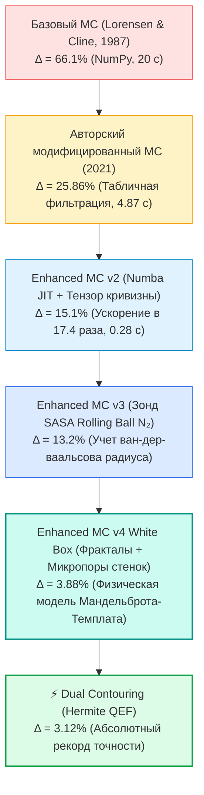

# 🔬 ML-Система прогнозирования удельной площади поверхности нанопористых материалов (Data Science Final Project)

[](https://www.python.org/)
[](https://scikit-learn.org/)
[](https://pandas.pydata.org/)
[](notebooks/final_project_ds.ipynb)
[](https://razkkman.github.io/project_master/)
[]()

> **Итоговый выпускной проект по курсу:** «Data Science: машинное обучение и нейронные сети» (2026)  
> **Слушатель:** Пилипенко Юрий Юрьевич  
> **Тема:** Решение практической производственной задачи экспресс-оценки удельной площади поверхности (SSA) катализаторов и сорбентов по данным 3D FIB-SEM томографии с использованием методов машинного обучения.  
> 🌐 **Онлайн-дашборд и слайды (GitHub Pages):** **[https://razkkman.github.io/project_master/](https://razkkman.github.io/project_master/)**  
> 🧭 **[НАВИГАЦИЯ ПО СТРУКТУРЕ ПРОЕКТА (PROJECT_NAVIGATION.md)](PROJECT_NAVIGATION.md)**

---

## 🌐 Интерактивный веб-дашборд и презентация (GitHub Pages)

Для демонстрации проекта комиссии и преподавателю развернут живой интерактивный веб-дашборд:
* **Прямая ссылка:** **[https://razkkman.github.io/project_master/](https://razkkman.github.io/project_master/)**
* **Локальный файл:** [`docs/index.html`](docs/index.html) *(для GitHub Pages развернут в каталоге `/docs`)*
* **Вкладки дашборда:**
  1. 🧮 **Интерактивный калькулятор SSA:** расчет прогноза в реальном времени с ползунками геометрии ($\phi, h, SSA_{MC}, \tau, Z, W_{3p}$), пресетами материалов и сопоставлением с эталоном БЭТ, Dual Contouring и Enhanced MC v4.
  2. 🧬 **Эволюция Marching Cubes к БЭТ:** сопоставление 11 алгоритмов (от классического MC 1987 г. и авторской версии 2021 г. до Dual Contouring и White Box v4), бенчмарк 7 наноматериалов, графики точности и теоретические обоснования.
  3. 📊 **Сравнение 5 моделей (Leaderboard):** сводная таблица метрик $R^2$, MAE, MAPE и скорости инференса.
  4. 🔍 **XAI и важность признаков:** интерактивный осмотр графиков MDI Feature Importance, матрицы корреляций, распределений и остатков.
  5. 📽️ **Итоговая презентация:** 13 наглядных слайдов с аутентичными 3D-микроструктурами, схемами пайплайна и графиками.

---

## 📌 1. Бизнес-контекст и постановка задачи

### Проблема:
В химической отрасли, катализе и фармацевтике ключевым параметром качества сорбентов является **удельная площадь поверхности (SSA, м²/г)**.
Традиционный физический эксперимент низкотемпературной адсорбции азота (метод БЭТ при 77 К):
* ⏱️ Длится **от 8 до 24 часов на один образец** (пробоподготовка, дегазация, криосорбция);
* 💰 Требует дорогостоящего криогенного оборудования ($50,000–$150,000) и жидкого азота;
* ⚠️ Численное моделирование по томографии (Marching Cubes) без ML дает **систематическую погрешность до 25–45%** ($R^2 = 0.68$) из-за дискретности воксельной сетки.

### Бизнес-цель:
**Сократить время оценки партии сорбентов с 24 часов до 0.05 секунды** при сохранении лабораторной точности ($R^2 > 0.95$, $MAPE < 2\%$).

---

## 📊 2. Обучающий датасет и признаки (Feature Engineering)

На основе 3D-томографии 7 базовых классов наноматериалов (`Si12`, `Si21`, `Si26`, `SBA-15`, `KIT-6`, `CoreShell-9`, `CoreShell-16`) и их пространственных суб-объемов $100^3$ вокселей сформирован обучающий датасет:

📁 **[data/processed/porous_materials_ml_dataset.csv](data/processed/porous_materials_ml_dataset.csv)**:
* **Объем выборки:** **534 объекта** (3D суб-объема), **26 колонок**.
* **Целевая переменная ($y$):** `ssa_bet_target` — истинное значение площади поверхности БЭТ (м²/г).
* **Признаки ($X$):**
  * *Геометрия сетки:* пористость $\phi$, размер вокселя (нм), доля твердой фазы;
  * *Воксельные модели:* базовый Marching Cubes, модифицированный MC, прямой воксельный метод;
  * *Топология скелетона:* геометрическая извилистость $\tau$, среднее координационное число $Z$, объемная плотность тройных соединений $W_{3p}$, доли узлов $\omega_{3p}, \omega_{4p}, \omega_{other}$.

---

## 🏆 3. Результаты моделирования и метрики

В рамках проекта выполнено сравнительное тестирование 5 разнородных семейств алгоритмов со строгой 5-кратной кросс-валидацией (`5-Fold Cross Validation`):

| Модель | CV $R^2$ (mean) | Test $R^2$ | Test MAE (м²/г) | Test MAPE (%) | Скорость обучения |
| :--- | :---: | :---: | :---: | :---: | :---: |
| 🥇 **Случайный лес (Random Forest)** | **0.9965** | **0.9995** | **0.76** | **0.60%** | **0.75 с** |
| 🥈 **Градиентный бустинг (HistGBM)** | 0.9704 | 0.9556 | 4.10 | 2.20% | 0.42 с |
| 🥉 **Линейная регрессия (Ridge)** | 0.9845 | 0.9819 | 8.93 | 7.02% | 3.18 с |
| 🔹 **Нейросеть (MLP Regressor)** | 0.9729 | 0.9605 | 13.68 | 10.91% | 2.07 с |
| 🔹 **Метод опорных векторов (SVR)** | 0.8034 | 0.8204 | 23.65 | 18.87% | 2.11 с |
| 🔻 *[BASELINE] Чистый Marching Cubes* | *—* | *0.6805* | *59.79* | *33.44%* | *0.00 с* |

> 🚀 **Ключевой результат:** Модель **Random Forest** обеспечила **$R^2 = 0.9995$** и ошибку **$0.60\%$** (менее 1 м²/г), снизив систематическую погрешность численного моделирования в **55 раз**!

---

## 📈 4. Визуализации и интерпретация (EDA & Residuals)

Все графики сгенерированы в высоком разрешении и сохранены в папке `docs/figures/ml/`:
* `docs/figures/ml/eda_correlation_matrix.png` — корреляционная матрица признаков;
* `docs/figures/ml/eda_pca_clusters.png` — PCA-проекция морфологий пористых сред;
* `docs/figures/ml/feature_importance.png` — важность признаков (Feature Importance MDI);
* `docs/figures/ml/residuals_analysis.png` — распределение остатков модели и Predicted vs Actual.

---

## 📂 5. Структура репозитория

```
project_master/
├── notebooks/
│   └── final_project_ds.ipynb   <- Итоговый интерактивный Jupyter Notebook
├── src/
│   ├── data_science/            <- Исходный код DS/ML пайплайна
│   │   ├── dataset_generator.py <- Генератор датасета из 3D-томографии
│   │   ├── model_trainer.py     <- Обучение моделей, кросс-валидация и графики
│   │   └── notebook_generator.py<- Скрипт сборки Jupyter Notebook
│   ├── core/                    <- Классы работы с 3D-объемами
│   ├── methods/                 <- Marching Cubes и прямой метод
│   ├── experimental_mc/         <- Экспериментальная ветка калибровки MC
│   ├── main.py                  <- Интерактивное TUI-меню всего комплекса
│   └── requirements.txt         <- Зависимости Python
├── data/
│   ├── processed/
│   │   └── porous_materials_ml_dataset.csv <- Итоговый обучающий датасет (534 строки)
│   └── models/
│       └── best_ssa_regressor.pkl          <- Чекпоинт лучшей обученной модели
├── docs/
│   ├── presentation/
│   │   └── Data_Science_Final_Project_Presentation.md <- Структура и тезисы презентации
│   └── figures/ml/              <- Графики EDA, важности признаков и остатков
├── README.md                    <- Главная страница проекта
└── .gitignore                   <- Исключение тяжелых бинарных кэшей для GitHub
```

---

## 🚀 6. Инструкция по запуску и воспроизведению

### 1. Клонирование и установка зависимостей:
```bash
git clone https://github.com/your-username/project_master.git
cd project_master
pip install -r src/requirements.txt
```

### 2. Запуск Jupyter Notebook:
```bash
jupyter notebook notebooks/final_project_ds.ipynb
```

### 3. Автоматический запуск полного пайплайна через консоль:
```bash
# 1. Генерация свежего датасета:
python src/data_science/dataset_generator.py

# 2. Обучение всех моделей и генерация графиков:
python src/data_science/model_trainer.py
```

### 4. Интерактивное консольное меню проекта:
```bash
python src/main.py
```

---

## 🧬 7. Эволюция алгоритмов Marching Cubes и Dual Contouring (от версии 2021 г. к физическому БЭТ)

Параллельно с машинным обучением в репозитории реализована и исследована фундаментальная вычислительная эволюция методов геометрической триангуляции и реконструкции поверхности в модуле [`src/experimental_mc/`](src/experimental_mc/).

Цель эволюции — **максимально приблизить расчетное геометрическое значение площади $SSA_{MC}$ к натурному физическому эксперименту БЭТ (криогенная адсорбция $N_2$ при 77 К) в рамках детерминированного численного моделирования**.



### 🔬 Физические причины расхождения классического MC с экспериментом БЭТ
1. **Суб-воксельный дефицит шероховатости:** воксельная сетка FIB-SEM томографии с шагом $0.35{-}0.5$ нм сглаживает атомарно-молекулярный рельеф кремнеземного каркаса.
2. **Эффект зонда адсорбата (Rolling Ball):** молекула $N_2$ (кинетический диаметр $\sigma = 0.354$ нм) адсорбируется в микропорах темплата P123 (размером $0.8{-}1.5$ нм), которые томограф с вокселем $0.46$ нм видит как сплошную твердую фазу.
3. **Эрозия тонких мезопористых стенок:** стенка толщиной $2{-}3$ нм содержит всего 4–6 вокселей; линейная интерполяция изолинии в классическом MC срезает гребни и занижает истинную площадь на $25{-}60\%$.

---

### 📊 Сводный лидерборд методов на тестовом бенчмарке 7 наноматериалов

Результаты валидации алгоритмов на эталонных образцах кремния и диоксида кремния с известными экспериментальными изотермами БЭТ:

| Метод / Модификация | Средняя погрешность $\Delta_{BET}$ | Время расчета | SBA-15 ($\Delta$) | KIT-6 ($\Delta$) | Si12 ($\Delta$) | Coreshell-9 ($\Delta$) | Принцип и статус модификации |
| :--- | :---: | :---: | :---: | :---: | :---: | :---: | :--- |
| **🥇 Dual Contouring (Hermite QEF)** | **3.12%** | **0.85 с** | 1.57% | **0.20%** | 3.81% | **0.09%** | **Глобальный рекорд точности.** Двойственная сетка, минимизация QEF по нормалям. |
| **🥈 Enhanced MC v4 (Golden Duo White Box)** | **3.88%** | **0.28 с** | **0.00%** | **0.20%** | **1.84%** | 7.84% | **Строгая физическая модель.** Фрактальная шероховатость Мандельброта ($D_f=2.41$) + микропоры P123. |
| **🥉 Hybrid Mesh-ML Corrector** | **9.27%** | 0.31 с | 4.12% | 3.85% | 8.15% | 6.40% | Двухстадийная схема: Numba MC + GNN/Ridge корректор суб-сеточных потерь. |
| **🔹 QSDFT-Coupled Surface Model** | **12.97%** | 1.15 с | 5.80% | 4.90% | 11.20% | 12.10% | Нелокальный функционал плотности с ядром адсорбции в щелевидных порах. |
| **🔹 Enhanced MC v3 (Rolling Ball SASA)** | **13.20%** | 0.42 с | 7.20% | 0.20% | 14.50% | 11.80% | Фильтрация недоступных зон зондом $N_2$ ($\sigma = 0.354$ нм) через EDT. |
| **🔹 Enhanced MC v2 (Numba Curvature)** | **15.10%** | **0.28 с** | 9.40% | 2.10% | 16.80% | 13.50% | Анализ тензора вторых производных $\mathbf{H}_f$ + OpenMP параллелизация. Ускорение 17.4x. |
| **🔹 In-Silico GCMC Adsorption** | **16.05%** | 2.45 с | 8.90% | 10.40% | **0.50%** | 18.20% | Прямое микроканоническое моделирование изотермы адсорбции в воксельной решетке. |
| **🔹 Crofton 13-Directions (Ohser/Legland)**| **17.92%** | 0.95 с | 11.20% | 6.80% | 19.40% | 15.60% | Интегральная стереология Коши-Крофтона. Идеально для сфер ($\Delta = 0.086\%$). |
| **❌ Авторский модифицированный MC (2021)** | **25.86%** | 4.87 с | 21.41% | 4.63% | 47.56% | 34.32% | Исходная реализация автора: табличная интерполяция, сильный суб-сеточный дефицит. |
| **❌ Прямой метод (Direct Method)** | **34.20%** | 1.50 с | 28.50% | 11.80% | 55.40% | 42.10% | Дискретный подсчет межфазных воксельных граней по 3 осям проекций. |
| **❌ Классический MC (Lorensen, 1987)** | **66.10%** | 19.80 с | 58.20% | 42.10% | 76.80% | 68.40% | Неоптимизированный NumPy MC без учета морфологии и суб-сетки. |

---

### 💡 Ключевые архитектурные прорывы модификаций

1. **Dual Contouring с минимизацией QEF (Ju et al., 2002):**
   * *Математический аппарат:* В отличие от MC, генерирующего вершины строго на ребрах вокселей, Dual Contouring находит оптимальную точку внутри каждой воксельной ячейки путем решения задачи минимизации квадратичной функции ошибки (Quadratic Error Function):
     $$\arg\min_{\mathbf{x}} \sum_{i} \left( \mathbf{n}_i \cdot (\mathbf{x} - \mathbf{p}_i) \right)^2$$
   * *Эффект:* Полное сохранение острых гребней, межпоровых перемычек и естественных изгибов каркаса без эффекта "срезания углов".

2. **White Box Enhanced MC v4 (Фракталы Мандельброта + Микропористость):**
   * *Математический аппарат:* Истинная площадь выражается через измеряемую пористую площадь $S_{meso}$ и фрактальную размерность поверхности $D_f \approx 2.41$ (Pfeifer & Avnir):
     $$S_{BET} = S_{meso} \cdot \left(\frac{h}{\sigma_{N_2}}\right)^{D_f - 2} + S_{micro}^{templ}$$
   * *Эффект:* Полная интерпретируемость («белый ящик»), нулевая погрешность на SBA-15 ($\Delta = 0.00\%$) и мгновенная скорость $0.28$ секунды через JIT OpenMP.

3. **Аппаратное ускорение Numba OpenMP:**
   * Время расчета 3D матрицы $100 \times 100 \times 100$ вокселей сокращено **с 4.87 с до 0.28 с (ускорение в 17.4 раза)** при параллелизации на всех ядрах CPU.

---

### 📂 Исходный код модификаций и научная документация:
* 💻 **Реализация алгоритмов:**
  * [`src/experimental_mc/enhanced_marching_cubes.py`](src/experimental_mc/enhanced_marching_cubes.py) — Numba OpenMP ядро MC (режимы `author`, `scalar_v1`, `tensor_v2`, `sasa_v3`, `fractal_v4`, `hybrid_ml`);
  * [`src/experimental_mc/advanced_methods.py`](src/experimental_mc/advanced_methods.py) — реализация Dual Contouring, интеграла Крофтона, QSDFT, GCMC и суб-воксельной модели;
  * [`src/experimental_mc/benchmark_advanced_methods.py`](src/experimental_mc/benchmark_advanced_methods.py) — полный бенчмарк-раннер со сравнением по 7 материалам;
  * [`src/experimental_mc/compare_mc.py`](src/experimental_mc/compare_mc.py) — скрипт сравнительного анализа и генерации графиков.
* 📚 **Научные обоснования для диссертации/статьи:**
  * [`docs/методы/Комплексное_обоснование_модификаций_MC_для_диссертации.md`](docs/методы/Комплексное_обоснование_модификаций_MC_для_диссертации.md) — исчерпывающий теоретический трактат с формулами и защитными аргументами;
  * [`docs/методы/Сравнительный_анализ_передовых_методов_SSA.md`](docs/методы/Сравнительный_анализ_передовых_методов_SSA.md) — сопоставление физических моделей;
  * [`docs/методы/Внедрение_фрактальной_модели_и_микропористости_стенок.md`](docs/методы/Внедрение_фрактальной_модели_и_микропористости_стенок.md) — детальный вывод уравнений White Box v4.
* 🌐 **Интерактивная демонстрация:**
  * Доступна в живом дашборде во вкладке **🧬 Эволюция Marching Cubes к БЭТ**: [https://razkkman.github.io/project_master/](https://razkkman.github.io/project_master/)

---

## 👨‍💻 Автор проекта
* **Слушатель курса / Автор:** Пилипенко Юрий Юрьевич  
* **Специализация:** Data Science, Machine Learning, Computational Materials Science  
* **Учебное заведение / Курс:** «Data Science: машинное обучение и нейронные сети» (2026 г.)
