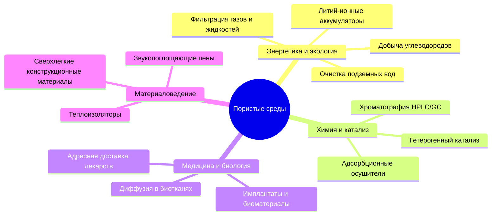

# Введение

Исследование пористых сред представляет собой фундаментальную междисциплинарную задачу, находящуюся на стыке радиофизики, физической химии, материаловедения, гидродинамики и биомедицины. 

## Актуальность проблемы

Пористые материалы с развитой внутренней структурой играют критически важную роль в широком спектре промышленных и научных приложений:
- **Гетерогенный катализ:** скорость и селективность каталитических реакций определяются доступностью активных центров на внутренней границе раздела фаз и эффективностью диффузионного переноса реагентов через каналы пор.
- **Хроматографическое разделение:** разрешающая способность колонок в высокоэффективной жидкостной хроматографии (ВЭЖХ) напрямую зависит от морфологии мезопористых кремниевых микросфер (например, частиц Core-Shell).
- **Фармацевтика и биомедицина:** мезопористые структуры (такие как SBA-15, MCM-41, KIT-6) служат высокоэффективными контейнерами для контролируемого высвобождения лекарственных молекул в целевых органах и тканях.
- **Электрохимическая энергетика:** структура порового пространства в электродах суперконденсаторов и аккумуляторов задает баланс между емкостью двойного электрического слоя и омическими потерями при транспорте электролита.

## Проблема экспериментальной диагностики геометрии пор

Морфология пористой среды характеризуется набором параметров:
- **Интегральные параметры:** общая пористость $\phi$ (доля объема пустот) и удельная площадь поверхности (Specific Surface Area, SSA).
- **Локальные геометрические и топологические параметры:** распределение пор по размерам (PSD), извилистость (тортуозность) каналов $\tau$, связность поровой сети, количество и тип узлов разветвления (координационные числа $Z$).

> [!WARNING] Ограничение традиционных методов
> Определение морфологических характеристик традиционными экспериментальными методами (газовая адсорбция, ртутная порозиметрия) дает интегральную, часто модельную оценку, усредненную по всему макроскопическому объему образца, и не позволяет непосредственно наблюдать реальную трехмерную архитектонику поровых каналов.

С другой стороны, прямая трехмерная томографическая реконструкция методом двухлучевой сканирующей электронной микроскопии со сфокусированным ионным пучком (**FIB-SEM**) сопряжена с существенными ограничениями:
1. Деструктивный характер метода (послойное травление ионами галлия безвозвратно уничтожает исследуемый микрообразец).
2. Чрезвычайная сложность, дороговизна оборудования и колоссальная трудоемкость съемки.
3. Ограниченный размер анализируемого объема (обычно единицы кубических микрометров), что порождает проблему репрезентативности элементарного объема (Representative Elementary Volume, REV).

## Постановка гипотезы и цели работы

В связи с этим возникает научно-практическая потребность: **установить количественные корреляционные зависимости между легко измеряемой интегральной макроскопической характеристикой — удельной площадью поверхности (SSA) — и внутренними топологическими характеристиками поровой сети (скелетона пористого пространства).**

Наличие подтвержденных корреляционных связей позволит исследователям и инженерам восстанавливать внутреннюю морфологию и предсказывать транспортные коэффициенты диффузии и проницаемости пористых материалов по простым сорбционным кривым, минуя необходимость трудоемкой 3D томографии.

---
**Связанные разделы базы знаний:**
- [[Index|Карта содержания]]
- [[00_Общая_характеристика_работы|Паспорт исследования]]
- [[01_Глава_1_Изучение_морфологии_пористых_сред|Глава 1. Изучение морфологии пористых сред]]
- [[методы/Теория_BET_и_физический_эксперимент|Теория BET и физический эксперимент]]
- [[методы/FIB_SEM_томография_и_бинаризация|FIB-SEM томография и бинаризация]]
