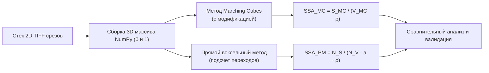

# Глава 2. Разработка, реализация и анализ алгоритмов расчета удельной площади поверхности

Вторая глава посвящена математическому моделированию, программной архитектуре и алгоритмической реализации двух методов вычисления удельной площади поверхности (SSA) на основе трехмерных воксельных моделей пористых структур.

---

## 2.1. Алгоритм формирования 3D массива из 2D изображений

Входными данными служат серии двумерных микрофотографий (сечений) пористых сред в формате TIFF.
Реализация алгоритма находится в модуле `src/Formirovanie_massiva_v1.py`:
1. **Чтение стека:** библиотека `skimage.io.imread` считывает последовательность срезов.
2. **Контроль четности измерений:** если пространственные размеры по осям ($N_x, N_y, N_z$) нечетные, выполняется усечение граничного слоя на 1 воксель для корректного разбиения пространства на кубические ячейки $2 \times 2 \times 2$.
3. **Бинаризация:** полутоновые пиксели со значением 255 (твердая фаза) преобразуются в логическую единицу `1`, а фоновые пиксели 0 (поровое пространство / пустота) — в `0`.
4. На выходе формируется трехмерный массив NumPy $A \in \{0, 1\}^{N_x \times N_y \times N_z}$.

---

## 2.2. Разработка и реализация алгоритма Marching Cubes для расчета SSA

Алгоритм **Marching Cubes** (Лоренсен и Клайн, 1987) был адаптирован для задачи прецизионного расчета удельной площади поверхности пористой матрицы. 

### Физико-геометрическое обоснование выбора:
В реальных мезопористых телах границы пор с размерами от 2 до 50 нм обладают гладкой или слабоволнистой кривизной. Прямая ступенчатая воксельная сетка существенно огрубляет границу раздела фаз. Метод Marching Cubes аппроксимирует истинную изоповерхность набором ориентированных треугольных полигонов, сглаживая ступенчатые артефакты дискретизации.

### Этапы работы алгоритма:
1. **Дискретизация элементарными кубами:** 3D массив покрывается элементарными кубическими ячейками, каждая из которых образована 8 смежными вокселями.
2. **Индексация вершин и векторизация:** 8 вершин куба нумеруются в фиксированном порядке от 0 до 7. Поскольку каждая вершина может принимать значение 0 или 1, существует ровно:
   $$2^8 = 256 \text{ различных конфигураций пересечения}$$
   Каждый куб взаимно однозначно отображается в 8-битное целое число (байт) от 0 до 255, служащее индексом в таблице поиска:
   $$\text{Index} = \sum_{k=0}^7 V_k \cdot 2^k$$
3. **Таблица поиска (Lookup Table):** таблица возвращает аналитически рассчитанную площадь полигональных треугольников $S_i$, отсекаемых изоповерхностью внутри ячейки, и объем твердой фазы $V_i$.

### Авторская модификация: устранение граничных потерь
> [!IMPORTANT] Критическая проблема стандартного Marching Cubes
> Стандартные реализации Marching Cubes ориентированы исключительно на визуализацию (рендеринг в компьютерной графике). При вычислении физической площади поверхности стандартный подход приводит к систематической потере фрагментов поверхности на гранях соприкосновения смежных кубов.  
> **Пример:** когда ячейка, целиком находящаяся внутри твердой фазы (все 8 вершин = 1, площадь внутри ячейки равна 0), граничит с ячейкой, имеющей на общей грани только 2 вершины твердой фазы. Граничный полигон на стыке ячеек стандартно теряется!

Для решения этой проблемы Ю.Ю. Пилипенко разработана оригинальная модификация:
- Реализованы вспомогательные модули `src/Chastnie_Sluchai.py`, `src/Chastnie_Sluchai_1.py`, `src/Chastnie_Sluchai_2.py` (суммарно более 3000 строк оптимизированного кода).
- При маршировании по сетке выполняется перекрестная проверка конфигураций смежных кубов.
- В случае несовпадения топологии на общей грани генерируется корректирующий вклад в итоговую площадь.

### Итоговый расчет удельной площади поверхности:
Полная площадь поверхности твердой фазы $S_{solid}$ и полный объем твердой фазы $V_{solid}$ вычисляются суммированием по всем $n$ кубам:
$$S_{solid} = \sum_{i=1}^n S_i \quad (2.1)$$
$$V_{solid} = \sum_{i=1}^n V_i \quad (2.2)$$

Удельная площадь поверхности рассчитывается по формуле:
$$SSA_{MC} = \frac{S_{solid}}{m_{solid}} = \frac{S_{solid}}{V_{solid} \cdot \rho} \quad (2.3)$$
где $\rho = 2.12 \times 10^6 \text{ г/м}^3 = 2.12 \text{ г/см}^3$ — физическая плотность кремниевой матрицы.

Программная реализация: модуль `src/MC_3D_v1_1.py`.

---

## 2.3. Разработка и реализация алгоритма прямого метода (Direct Method)

В качестве эталона для сравнительного анализа разработан и реализован прямой воксельный метод (модуль `src/Pryamoy_metod.py`).

### Принцип работы прямого метода:
1. Выполняется сканирование 3D массива вдоль трех декартовых осей координат:
   - по оси $X$: проверка условия $A[i, j, k] \ne A[i+1, j, k]$
   - по оси $Y$: проверка условия $A[i, j, k] \ne A[i, j+1, k]$
   - по оси $Z$: проверка условия $A[i, j, k] \ne A[i, j, k+1]$
2. Подсчитывается суммарное количество элементарных фазовых переходов $N_S$ между пустотой (0) и твердой фазой (1).
3. Площадь поверхности твердой фазы равна суммарной площади всех элементарных квадратных воксельных граней размера $a \times a$:
   $$S = N_S \cdot a^2 \quad (2.4)$$
4. Объем твердой фазы определяется прямым подсчетом количества единичных вокселей $N_V$:
   $$V = N_V \cdot a^3 \quad (2.5)$$
5. Удельная площадь поверхности:
   $$SSA_{direct} = \frac{S}{m} = \frac{N_S \cdot a^2}{N_V \cdot a^3 \cdot \rho} = \frac{N_S}{N_V \cdot a \cdot \rho} \quad (2.6)$$

---

## 2.4. Сравнительный анализ алгоритмической сложности

| Критерий | Прямой метод (PM) | Адаптированный Marching Cubes (MC) |
| :--- | :--- | :--- |
| **Временная сложность** | $O(N_x N_y N_z)$ — предельно высокая скорость | $O(N_x N_y N_z)$ — с дополнительными накладными расходами на перекрестную валидацию |
| **Геометрическая модель** | Манхэттенская ступенчатая граница (воксельные грани) | Сглаженная полигональная сетка (триангуляция) |
| **Учет ориентации граней** | Не учитывает угол наклона поверхности (завышает площадь наклонных плоскостей на величину до $\sqrt{3} \approx 1.73$) | Точно аппроксимирует наклонные и криволинейные границы раздела |
| **Устойчивость к разрешению** | Сильно деградирует при огрублении шага сетки | Сохраняет устойчивость благодаря полигональной интерполяции |

---

## 2.5. Основные результаты и выводы по главе 2
1. Разработан и реализован эффективный программный конвейер для преобразования стеков 2D микрофотографий FIB-SEM в трехмерные расчетные массивы.
2. Создана авторская модификация метода Marching Cubes, устраняющая фундаментальную проблему потери межъячеечной площади поверхности.
3. Реализован прямой метод подсчета воксельных переходов как базисный метод сопоставления.
4. Выявлены теоретические предпосылки превосходства адаптированного Marching Cubes над прямым методом при моделировании криволинейных поверхностей мезопор.

---
**Связанные разделы базы знаний:**
- [[Index|Карта содержания]]
- [[методы/Метод_Marching_Cubes|Детальное описание Marching Cubes]]
- [[методы/Модификация_Marching_Cubes_учет_потерь|Модификация учета потерь]]
- [[методы/Прямой_метод_расчета_SSA|Прямой метод расчета SSA]]
- [[03_Глава_3_Анализ_результатов_и_взаимосвязи_морфологии|Глава 3. Результаты и анализ]]
