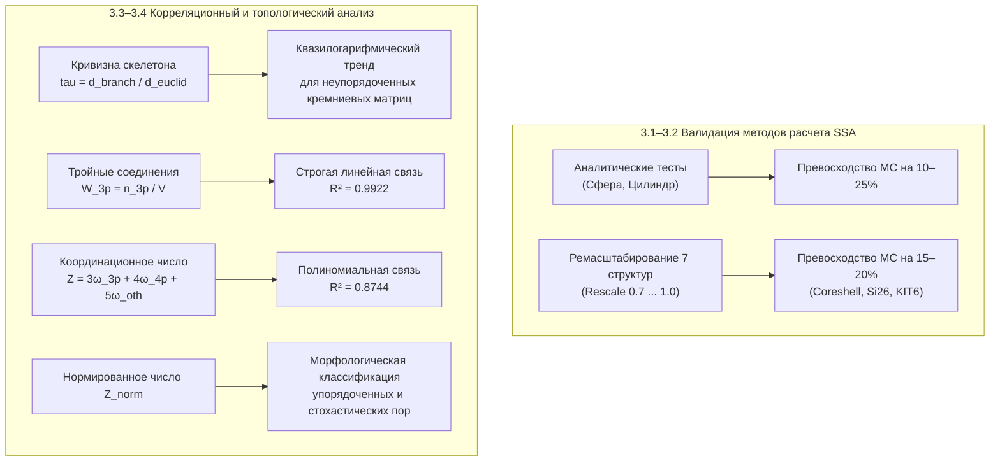

# Глава 3. Анализ полученных результатов

Третья глава содержит результаты экспериментальной и численной валидации разработанных алгоритмов, исследование сеточной сходимости, а также анализ фундаментальных корреляционных связей между удельной площадью поверхности (SSA) и морфологическими параметрами скелетона пористого пространства.

---

## 3.1. Исследование эффективности алгоритмов на калибровочных телах (сфера и цилиндр)

Для строгой валидации алгоритмов использованы дискретизированные геометрические тела правильной формы, для которых удельная площадь поверхности вычисляется строго аналитически.

### Аналитические зависимости:
Для сферы радиуса $r_{сферы}$:
$$SSA_{сферы} = \frac{4 \pi r^2}{\frac{4}{3} \pi r^3 \cdot \rho} = \frac{3}{r_{сферы} \cdot \rho} \quad (3.1)$$

Для цилиндра радиуса $r_{цилин}$ и высоты $h_{цилин}$:
$$SSA_{цилиндра} = \frac{2 \pi r^2 + 2 \pi r h}{\pi r^2 h \cdot \rho} = \frac{2 (r_{цилин} + h_{цилин})}{r_{цилин} \cdot h_{цилин} \cdot \rho} \quad (3.2)$$

Относительная ошибка методов рассчитывается относительно аналитического номинала:
$$\Delta_{MC} = \frac{|SSA_{MC} - SSA_{analit}|}{SSA_{analit}} \times 100\% \quad (3.3)$$
$$\Delta_{PM} = \frac{|SSA_{PM} - SSA_{analit}|}{SSA_{analit}} \times 100\% \quad (3.4)$$

### Результаты для дискретизированной сферы (Таблица 3.1):

| Диаметр сферы $d$, вокселей | $\Delta_{MC}$, % (Marching Cubes) | $\Delta_{PM}$, % (Прямой метод) | Разность точности, % |
| :---: | :---: | :---: | :---: |
| 3 | 136.60 | 114.29 | -22.31 (ПМ лучше) |
| 5 | **87.11** | 96.97 | +9.86 (MC лучше) |
| 7 | **52.73** | 65.04 | +12.31 |
| 9 | **50.74** | 71.60 | +20.86 |
| 11 | **49.75** | 73.01 | +23.26 |
| 13 | **39.61** | 58.81 | +19.20 |
| 15 | **37.04** | 57.51 | +20.47 |
| 17 | **37.93** | 58.80 | +20.87 |
| 19 | **36.03** | 56.53 | +20.50 |
| 21 | **38.04** | 59.68 | +21.64 |
| 23 | **34.68** | 55.53 | +20.85 |
| 25 | **33.81** | 54.13 | +20.32 |
| 27 | **34.68** | 55.74 | +21.06 |
| 29 | **33.38** | 54.12 | +20.74 |

> [!NOTE] Вывод по тестам на сфере
> При $d \ge 5$ вокселей модифицированный метод Marching Cubes демонстрирует стабильное и абсолютное превосходство над прямым методом, превосходя его по точности более чем на 20%.

### Результаты для дискретизированного цилиндра:
- При фиксированной высоте ($h=5$) и варьировании диаметра $d$ метод Marching Cubes оказался точнее прямого метода на 5–10% для всех сечений.
- При фиксированном диаметре ($d=5$) и увеличении высоты $h$ Marching Cubes сохраняет устойчивое преимущество в 8–15%.

---

## 3.2. Исследование сеточной сходимости на моделях пористых сред

Для исследования устойчивости алгоритмов к пространственному разрешению воксельной сетки выполнено ремасштабирование (rescaling) 3D массивов с масштабными коэффициентами $k \in \{0.7, 0.75, 0.8, 0.85, 0.9, 0.95, 1.0\}$.

Доля пористости (объемная доля пустот) определялась по формуле:
$$\phi = 1 - \frac{N_V}{N_{total}} \quad (3.5)$$

### Таблица пористости исследуемых структур (Таблица 3.4):

| Структура | Пористость $\phi$ | Тип мезоструктуры | Преобладающий метод |
| :--- | :---: | :--- | :--- |
| **Coreshell16** | 0.370 | Частицы ядро-оболочка (оболочка 16 нм) | **Marching Cubes** (точнее на 15–20%) |
| **Coreshell9** | 0.302 | Частицы ядро-оболочка (оболочка 9 нм) | **Marching Cubes** (точнее на 15–20%) |
| **Si26** | 0.702 | Травленый кремний (поры 26 нм) | **Marching Cubes** (точнее на 15–20%) |
| **KIT6** | 0.649 | Упорядоченный гироид | **Marching Cubes** (точнее на 15–20%) |
| **Si21** | 0.649 | Травленый кремний (поры 21 нм) | Паритет (MC лучше при $k \le 0.85$) |
| **SBA15** | 0.487 | Упорядоченная гексагональная | Паритет (MC лучше при $k \le 0.90$) |
| **Si12** | 0.577 | Травленый кремний (поры 12 нм) | Прямой метод (артефакт шероховатости) |

### Анализ результатов:
1. Для `Coreshell16`, `Coreshell9`, `Si26` и `KIT6` метод Marching Cubes показал полное превосходство, обеспечивая значения SSA, более близкие к данным физического эксперимента BET на 15–20%.
2. Огрубление сетки (уменьшение $k$) закономерно увеличивает погрешность вычисления SSA со средним темпом 4–8% на шаг масштабирования.
3. Аномальное поведение `Si12` (где прямой метод формально дал меньшую ошибку относительно BET) объясняется высокой микрошероховатостью стенок пор малого диаметра (12 нм) и ограниченным объемом томографической выборки (проблема репрезентативности REV).

---

## 3.3. Взаимосвязь удельной площади поверхности и искривленности ветвей скелетона

Исследуемые материалы разделены на две группы:
- **Упорядоченные мезопоры:** `SBA15` (гексагональные каналы), `KIT6` (гироидная сетка).
- **Неупорядоченные (стохастические) мезопоры:** `Si12`, `Si21`, `Si26`, `Coreshell9`, `Coreshell16`.

Средняя геометрическая кривизна (тортуозность) ветвей скелетона определяется как отношение фактической длины ветви вдоль графа к евклидову расстоянию между узлами:
$$\overline{\tau} = \frac{1}{n} \sum_{i=1}^n \frac{d_{branch, i}}{d_{euclid, i}} \quad (3.6)$$

Для отсечения краевых и шумовых артефактов анализировались только связные скелетоны, содержащие $N > 500$ ветвей (скрипт `src/Skeleton_tau.py`).

### Результаты анализа зависимости $\overline{\tau}(SSA)$:
1. Образцы серии кремния с идентичной предысторией синтеза (`Si12`, `Si21`, `Si26`) формируют четкую закономерность:  
   **Увеличение диаметра пор (от 12 до 26 нм) приводит к снижению шероховатости, росту пористости $\phi$, снижению кривизны ветвей $\overline{\tau}$ и монотонному уменьшению удельной площади поверхности.**
2. Образцы `Coreshell9` и `Coreshell16` выпадают из общего тренда ввиду принципиально иной геометрии (тонкий мезопористый слой на сплошном сферическом ядре).
3. При исключении Core-Shell структур зависимость $\overline{\tau}$ от SSA имеет форму, близкую к логарифмической ветви.

---

## 3.4. Взаимосвязь SSA с количеством соединений ветвей скелетона

### Анализ гистерезисов адсорбции/десорбции:
Сопоставление изотерм сорбции с морфологическими параметрами порового пространства, занятого газовой фазой, выявило идентичность формы гистерезиса удельной площади поверхности и количества тройных соединений ветвей скелетона.
Коэффициенты линейной корреляции между кривыми SSA и $n_{3p}$:
- для кривой адсорбции: $r = 0.9907$
- для кривой десорбции: $r = 0.9903$

### Нормированное количество тройных соединений ($W_{3p}$):
$$W_{3p} = \frac{n_{3p}}{V_{solid}} \quad (3.7)$$
где $n_{3p}$ — суммарное число тройных узлов ветвления, $V_{solid}$ — объем твердой фазы пористой структуры.

> [!IMPORTANT] Ключевой научный результат
> Анализ графика зависимости $W_{3p}$ от удельной площади поверхности SSA показал **строгую линейную связь**. Линейная регрессия характеризуется коэффициентом детерминации:
> $$R^2 = 0.9922$$
> Это подтверждает гипотезу о том, что удельная площадь поверхности мезопористой матрицы прямо пропорциональна пространственной плотности тройных узлов поровой сети.

### Координационное число ветвления ($Z$):
Доли тройных, четверных и высших соединений в скелетоне:
$$\omega_{3p} = \frac{n_{3p}}{N} \quad (3.8)$$
$$\omega_{4p} = \frac{n_{4p}}{N} \quad (3.9)$$
$$\omega_{other} = \frac{n_{other}}{N} \quad (3.10)$$
где $N = n_{3p} + n_{4p} + n_{other}$ — общее число соединений скелетона.

Среднее координационное число ветвления скелетона:
$$Z = 3 \cdot \omega_{3p} + 4 \cdot \omega_{4p} + 5 \cdot \omega_{other} \quad (3.11)$$

Нормированное координационное число:
$$Z_{norm} = \frac{Z}{V_{solid}} \quad (3.12)$$

### Аппроксимация зависимости $Z(SSA)$:
Зависимость среднего координационного числа $Z$ от SSA аппроксимируется:
- Полиномом 3-й степени: $R^2 = 0.8744$ (наилучшее соответствие)
- Логарифмической функцией: $R^2 = 0.8436$

### Классификационный потенциал $Z_{norm}$:
На двумерной диаграмме в координатах $(SSA, Z_{norm})$ все образцы со стохастической структурой пор концентрируются в компактном кластере в нижнем левом углу, тогда как упорядоченные мезоструктуры (`SBA15`, `KIT6`) резко обособлены. Это позволяет использовать пару параметров $(SSA, Z_{norm})$ для автоматической классификации типа пористой архитектоники.

---

## 3.5. Основные результаты и выводы по главе 3
1. На калибровочных аналитических моделях (сфера, цилиндр) доказано превосходство модифицированного алгоритма Marching Cubes над прямым методом (выигрыш в точности составляет 10–25%).
2. Для реальных пористых структур подтверждена более высокая устойчивость Marching Cubes к огрублению шага сетки.
3. Обнаружена фундаментальная линейная зависимость между удельной площадью поверхности (SSA) и нормированным числом тройных узлов скелетона $W_{3p}$ ($R^2 = 0.9922$).
4. Установлена нелинейная (квазилогарифмическая) зависимость координационного числа $Z$ от SSA ($R^2 = 0.8744$).
5. Показана возможность классификации мезопористых сред на упорядоченные и неупорядоченные по параметрам $Z_{norm}$ и SSA.

---
**Связанные разделы базы знаний:**
- [[Index|Карта содержания]]
- [[методы/Анализ_кривизны_ветвей_скелетона|Метод: Анализ кривизны]]
- [[методы/Анализ_узлов_и_координационных_чисел|Метод: Узлы и координационные числа]]
- [[структуры/Обзор_исследуемых_пористых_структур|Характеристики структур]]
- [[04_Заключение_и_выводы|Заключение диссертации]]
