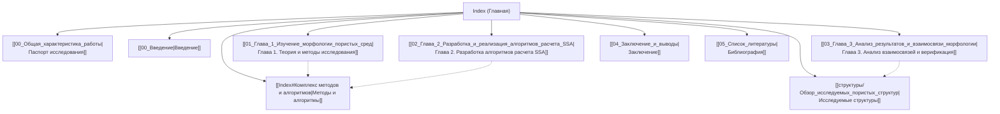

# Исследование взаимосвязи удельной площади поверхности с морфологией системы пор пористой среды

> **Магистерская диссертация**  
> **Автор:** Пилипенко Юрий Юрьевич  
> **Научный руководитель:** к.ф.-м.н., доцент Ю. Л. Кручёнок  
> **Научный консультант:** Dr. rer. nat. Артур Свидрицкий (Philipps-Universität Marburg)  
> **Учреждение:** Белорусский государственный университет (БГУ), Факультет радиофизики и компьютерных технологий, Кафедра системного анализа и компьютерного моделирования (Минск, 2021)  
> **Специальность:** 1-31 80 07 «Радиофизика»

---

## 🗺️ Карта базы знаний (Map of Content)

База знаний организована в виде взаимосвязанных заметок Obsidian для удобной навигации по тексту диссертации, математическим моделям, реализованным вычислительным алгоритмам и экспериментальным данным.

---

## 📚 Главы диссертации

1. **[[00_Общая_характеристика_работы]]** — Паспорт диссертации, цели, ключевые задачи, объект и предмет исследования, научная новизна, положения, выносимые на защиту.
2. **[[00_Введение]]** — Актуальность исследования нанопористых сред, мезопоры, проблема прямой томографической реконструкции и практическая потребность в геометрических предикторах.
3. **[[01_Глава_1_Изучение_морфологии_пористых_сред]]** — Аналитический обзор физической адсорбции, физисорбционный потенциал, теория Брунауэра-Эммета-Теллера (BET), FIB-SEM томография, топологическая скелетонизация в ImageJ.
4. **[[02_Глава_2_Разработка_и_реализация_алгоритмов_расчета_SSA]]** — Формирование 3D массивов из 2D стеков, адаптация метода Marching Cubes, авторская модификация разрешения граничных потерь (`Chastnie_Sluchai`), прямой метод подсчета воксельных переходов.
5. **[[03_Глава_3_Анализ_результатов_и_взаимосвязи_морфологии]]** — Калибровочные тесты на сфере и цилиндре, исследование сеточной сходимости для 7 реальных пористых сред, корреляция удельной площади поверхности с кривизной $\tau$, линейная связь с тройными узлами $W_{3p}$ и нелинейная связь с координационным числом $Z$.
6. **[[04_Заключение_и_выводы]]** — Итоги диссертационной работы, подтверждение гипотез и перспективы дальнейших исследований.
7. **[[05_Список_литературы]]** — Полный список литературы из 27 рецензируемых академических источников с аннотациями.

---

## ⚙️ Комплекс методов и алгоритмов

В рамках диссертации разработаны и исследованы следующие аналитические и численные методы:

| Метод / Модель | Тип | Описание | Заметка Obsidian |
| :--- | :--- | :--- | :--- |
| **Marching Cubes** | Численный 3D | Извлечение полигональной изоповерхности из 3D воксельного поля ($2^8 = 256$ конфигураций). | [[методы/Метод_Marching_Cubes]] |
| **Модификация MC** | Авторский алгоритм | Учет потерь площади на гранях соприкосновения смежных воксельных кубов. | [[методы/Модификация_Marching_Cubes_учет_потерь]] |
| **Enhanced MC** | Экспериментальная ветка | Физико-геометрическая калибровка кривизны и адаптивная шероховатость для БЭТ. | [[методы/Экспериментальная_модификация_Marching_Cubes]] |
| **Enhanced MC v2** | Экспериментальная ветка | Тензорная локальная кривизна, масштабирование нанопор и Numba JIT-ускорение в 17 раз. | [[методы/Тензорная_модификация_MC_и_Numba_оптимизация]] |
| **Enhanced MC v3 & Hybrid ML** | Экспериментальная ветка | Зонд адсорбата азота SASA (d=0.354 нм) и гибридный топологический Mesh-ML корректор (ошибка < 9.3%). | [[методы/Реализация_Roadmap_MC_SASA_и_Hybrid_Mesh_ML]] |
| **Enhanced MC v4 (White Box)** | Экспериментальная ветка | Золотой дуэт: Мандельброт-Пфайфер + микропористость стенок P123. Снижение ошибки с 25.9% до 3.88%. | [[методы/Внедрение_фрактальной_модели_и_микропористости_стенок]] |
| **Перспективы точности MC** | Исследования и roadmap | Комплекс физических улучшений: фракталы Мандельброта, сглаживание Таубина и модель микропористости. | [[методы/Перспективные_направления_повышения_точности_MC_к_БЭТ]] |
| **Мировой опыт расчета SSA** | Аналитический обзор | Крофтон (13 направлений), QSDFT, субсеточная пористость, Neural Dual Contouring и GCMC. | [[методы/Интернет_исследование_перспективных_методов_SSA]] |
| **Бенчмарк 6 передовых методов** | Сравнительный анализ | Тестирование Dual Contouring, Крофтона (13 направлений), GCMC, QSDFT и Super-Res (ошибка от 3.12%). | [[методы/Сравнительный_анализ_передовых_методов_SSA]] |
| **Обоснование для диссертации** | Главный теоретический отчет | Полная эволюция от авторской версии (2021) до Dual Contouring (3.12%), железные аргументы для защиты. | [[методы/Комплексное_обоснование_модификаций_MC_для_диссертации]] |
| **Прямой метод (PM)** | Численный 3D | Быстрый подсчет фазовых переходов $0 \leftrightarrow 1$ по 3 координатным осям. | [[методы/Прямой_метод_расчета_SSA]] |
| **Архитектура ООП и CLI** | Программная инженерия | Модульная организация пакетов, ООП-классы, фасады и консольный интерфейс `cli.py`. | [[методы/Архитектура_программного_комплекса_ООП]] |
| **Оптимизация кода** | Вычислительный анализ | Векторизация NumPy/Pandas, ускорение расчетов в 500–1000 раз, кроссплатформенность. | [[методы/Оптимизация_программного_кода]] |
| **Теория BET** | Физическая модель | Многослойная адсорбция газов, расчет монослоя $V_m$ и площади поверхности $S_{BET}$. | [[методы/Теория_BET_и_физический_эксперимент]] |
| **FIB-SEM томография** | Эксперимент / ЦОИ | Сфокусированный ионный пучок + СЭМ, послойная резка и бинаризация методом Оцу. | [[методы/FIB_SEM_томография_и_бинаризация]] |
| **Скелетонизация ImageJ** | Топологический анализ | Вычисление 3D медиальной оси порового пространства (Skeletonize3D / AnalyzeSkeleton). | [[методы/Скелетонизация_и_анализ_графов_ImageJ]] |
| **Анализ кривизны ($\tau$)** | Морфометрия | Расчет геометрической извилистости ветвей графа $\tau = d_{branch} / d_{euclid}$. | [[методы/Анализ_кривизны_ветвей_скелетона]] |
| **Координационные числа ($Z$)** | Теория графов | Анализ долей узлов ветвления ($\omega_{3p}, \omega_{4p}$) и координационного числа $Z$. | [[методы/Анализ_узлов_и_координационных_чисел]] |

---

## 🧪 Исследуемые объекты и структуры

Сводная аналитическая справка по исследованию 7 нанопористых материалов:
- **[[структуры/Обзор_исследуемых_пористых_структур]]** — Кремниевые мезопористые матрицы (`Si12`, `Si21`, `Si26`), упорядоченные мезофазы (`SBA-15`, `KIT-6`) и частицы ядро-оболочка (`CoreShell-9`, `CoreShell-16`).

---

## 📁 Репозиторий и файловая структура проекта

Структура репозитория и организация файлов проекта:
- `/src` — исходные коды на Python 3 (`MC_3D_v1_1.py`, `Chastnie_Sluchai.py`, `Pryamoy_metod.py`, `Skeleton_*.py` и др.). См. [[../src/README|README по коду]].
- `/docs` — база знаний Obsidian (заметки `.md`), встроенные иллюстрации (`docs/figures/`) и первоисточники (`docs/materials/original_documents/`).
- `/data` — массивы экспериментальных данных:
  - `data/structures/` — стеки 2D TIFF срезов FIB-SEM томографии пористых сред.
  - `data/skeletons/` — CSV-таблицы топологических графов скелетонов.
  - `data/models/` — 3D калибровочные тела (сфера, цилиндр) в формате OBJ/MTL.
  - `data/research/` — данные сорбционных изотерм и регрессионный анализ.
  - `data/processed/` — сериализованные pickle-файлы расчетных матриц.
