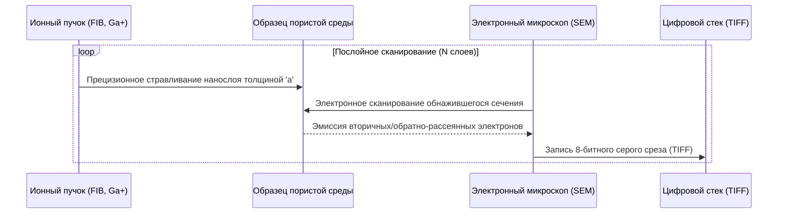

# FIB-SEM томография и цифровая бинаризация пористых структур

Метод **двухлучевой сканирующей электронной микроскопии со сфокусированным ионным пучком (FIB-SEM, Focused Ion Beam — Scanning Electron Microscopy)** — передовая технология прецизионной трехмерной нанотомографии плотных и нанопористых материалов с субнанометровым пространственным разрешением.

В диссертации стеки 2D микрофотографий, полученные методом FIB-SEM, послужили основой для формирования трехмерных воксельных массивов исследуемых кремниевых пористых сред.

---

## Принцип работы двухлучевой системы FIB-SEM

Прибор объединяет в единой вакуумной камере две сфокусированные колонны, ориентированные под углом (обычно $52^\circ$ друг к другу):
1. **Ионная колонна (FIB):** пучок ускоренных ионов галлия ($Ga^+$) производит ультратонкое послойное срезание (нанофрезерование) контролируемого слоя материала толщиной от доли нанометра до единиц нанометров.
2. **Электронная колонна (SEM):** пучок электронов высокой энергии сканирует обнажившийся плоский срез и регистрирует сигналы вторичных (SE) и/или обратно-рассеянных (BSE) электронов, формируя высококонтрастную двумерную микрофотографию сечения.

В результате непрерывного циклического процесса формируется упорядоченный стек двумерных изображений сечений образца с известным шагом между срезами $\Delta z = a$ и латеральным разрешением пикселя $\Delta x = \Delta y = a$.

---

## Предобработка и фильтрация изображений

Сырые микрофотографии FIB-SEM требуют предварительной цифровой обработки:
1. **Коррекция дрейфа (Image Alignment):** компенсация теплового и электростатического смещения образца в процессе длительной многочасовой съемки.
2. **Устранение «шторного эффекта» (Curtaining effect):** удаление вертикальных полос, возникающих из-за локальной неоднородности коэффициента распыления ионным пучком.
3. **Фильтрация шумов:** применение нелинейных медианных и анизотропных диффузионных фильтров для подавления дробового шума детектора с сохранением резкости границ пор.

---

## Бинаризация пористой матрицы: Метод Оцу (Otsu's Thresholding)

Для перехода от полутонового распределения яркостей $I \in [0, 255]$ к бинарному представлению $A \in \{0, 1\}$ (где 0 — пора, 1 — твердая фаза кремния) критически важно безошибочно определить пороговое значение яркости $T$.

В проекте используется метод глобальной пороговой бинаризации Оцу (скрипт `src/Opredelenie_poroga.py`).

### Математический аппарат метода Оцу:
Алгоритм ищет порог $T^*$, который максимизирует межклассовую дисперсию $\sigma_B^2(T)$ (или, что эквивалентно, минимизирует внутриклассовую дисперсию):

$$\sigma_B^2(T) = \omega_0(T) \cdot \omega_1(T) \cdot [\mu_0(T) - \mu_1(T)]^2$$
где:
- $\omega_0(T) = \sum_{i=0}^T p_i$ — вероятность принадлежности пикселя к классу «пустота» (фоновые поры),
- $\omega_1(T) = \sum_{i=T+1}^{255} p_i$ — вероятность принадлежности к классу «твердая фаза»,
- $\mu_0(T), \mu_1(T)$ — средние арифметические уровни яркости соответствующих классов,
- $p_i = \frac{n_i}{N}$ — нормированная гистограмма распределения уровней серого тона.

Оптимальный порог определяется одномерным перебором по всему диапазону яркостей:
$$T^* = \arg\max_{0 \le T < 255} \sigma_B^2(T)$$

---

## Контроль качества сегментации
После автоматического применения порога $T^*$ выполняется визуальный и статистический контроль:
- Сравнение контуров исходного серого среза и бинарной маски.
- Сопоставление полученной расчетной пористости $\phi = 1 - \frac{N_V}{N_{total}}$ с независимыми данными ртутной порозиметрии и сорбции.

---
**Связанные разделы базы знаний:**
- [[Index|Карта содержания]]
- [[01_Глава_1_Изучение_морфологии_пористых_сред|Глава 1. Изучение морфологии пористых сред]]
- [[02_Глава_2_Разработка_и_реализация_алгоритмов_расчета_SSA|Глава 2. Формирование 3D массива]]
- [[методы/Скелетонизация_и_анализ_графов_ImageJ|Скелетонизация бинарных моделей]]
- [[структуры/Обзор_исследуемых_пористых_структур|Характеристики исследуемых структур]]
