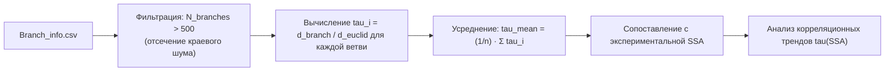

# Анализ геометрической кривизны (извилистости / тортуозности) ветвей скелетона

**Геометрическая извилистость (кривизна, тортуозность, $\tau$)** — ключевая безразмерная морфологическая характеристика пористой матрицы, определяющая степень отклонения поровых каналов от прямолинейной траектории.

В диссертации Ю.Ю. Пилипенко исследована гипотеза о наличии функциональной взаимосвязи между степенью искривленности скелетона порового объема и макроскопической удельной площадью поверхности (SSA).

---

## Математическое определение и алгоритм расчета

Для каждой индивидуальной ветви графа скелетона, соединяющей два смежных узла сочленения, извлекаются две длины:
1. **$d_{branch}$ (Branch length):** длина пути вдоль искривленной оси канала, вычисленная воксельным суммированием с поправками на диагональные переходы.
2. **$d_{euclid}$ (Euclidean distance):** прямое геометрическое расстояние между начальным и конечным узлами ветви:
   $$d_{euclid} = \sqrt{(x_2 - x_1)^2 + (y_2 - y_1)^2 + (z_2 - z_1)^2}$$

Коэффициент локальной геометрической извилистости $i$-й ветви определяется как:
$$\tau_i = \frac{d_{branch, i}}{d_{euclid, i}} \ge 1$$

По определению, $\tau_i = 1$ для абсолютно прямого канала; чем сильнее искривлен или изогнут канал, тем больше значение $\tau_i$.

Среднее значение геометрической кривизны по всей пористой структуре:
$$\overline{\tau} = \frac{1}{n} \sum_{i=1}^n \frac{d_{branch, i}}{d_{euclid, i}} \quad (3.6)$$
где $n$ — количество проанализированных ветвей.

---

## Фильтрация шумов и статистическая достоверность

В процессе скелетонизации вблизи границ расчетного объема или из-за дискретной шероховатости стенок образуются мелкие ложные ветви-«усики» (краевой шум). 
Если усреднять все изолированные фрагменты, результат окажется искаженным.

В алгоритме (скрипт `src/Skeleton_tau.py`) реализована процедура фильтрации:
- Выполняется группировка ветвей по их `Skeleton ID`.
- В расчет включаются только крупные непрерывные связанные компоненты скелетона, содержащие:
  $$N_{branches} > 500$$
- Ветви длиной в 1 воксель ($d_{euclid} = 0$) исключаются из рассмотрения во избежание деления на ноль.

---

## Результаты исследования зависимости $\overline{\tau}$ от SSA

Сопоставление средней кривизны ветвей скелетона $\overline{\tau}$ с удельной площадью поверхности SSA выявило следующие закономерности:

1. **Группа кремниевых образцов (`Si12`, `Si21`, `Si26`):**
   - Все три образца получены при одинаковых условиях синтеза, но различаются временем травления.
   - Минимальное время травления (`Si12`, размер пор 12 нм) приводит к формированию сильно развитой, шероховатой поверхности мезопор: наблюдается максимальная удельная площадь поверхности ($SSA = 315\text{ м}^2/\text{г}$), максимальная извилистость скелетона ($\overline{\tau}$) и наименьшая пористость ($\phi = 0.577$).
   - По мере увеличения времени травления до 21 нм (`Si21`) и 26 нм (`Si26`) поры расширяются, их стенки сглаживаются: кривизна скелетона монотонно падает, а SSA снижается до $129\text{ м}^2/\text{г}$.
2. **Форма функциональной связи:**
   - Для серии кремниевых структур и упорядоченных матриц (`SBA15`, `KIT6`) зависимость $\overline{\tau}(SSA)$ демонстрирует выраженную квазилогарифмическую тенденцию.
3. **Аномалия структур Core-Shell (`Coreshell9`, `Coreshell16`):**
   - Данные образцы состоят из плотного сплошного ядра и тонкого пористого поверхностного слоя, что накладывает сильные геометрические ограничения на длины ветвей и выводит их из общей логарифмической кривой.

> [!NOTE] Вывод
> Удельная площадь поверхности оказывает существенное влияние на извилистость поровой сети, однако одного значения SSA недостаточно для однозначного предсказания $\overline{\tau}$ без учета морфологического типа пористости (сплошная матрица vs частицы ядро-оболочка).

---
**Связанные разделы базы знаний:**
- [[Index|Карта содержания]]
- [[методы/Скелетонизация_и_анализ_графов_ImageJ|Скелетонизация ImageJ]]
- [[методы/Анализ_узлов_и_координационных_чисел|Анализ узлов и связности]]
- [[03_Глава_3_Анализ_результатов_и_взаимосвязи_морфологии|Глава 3. Обсуждение результатов]]
