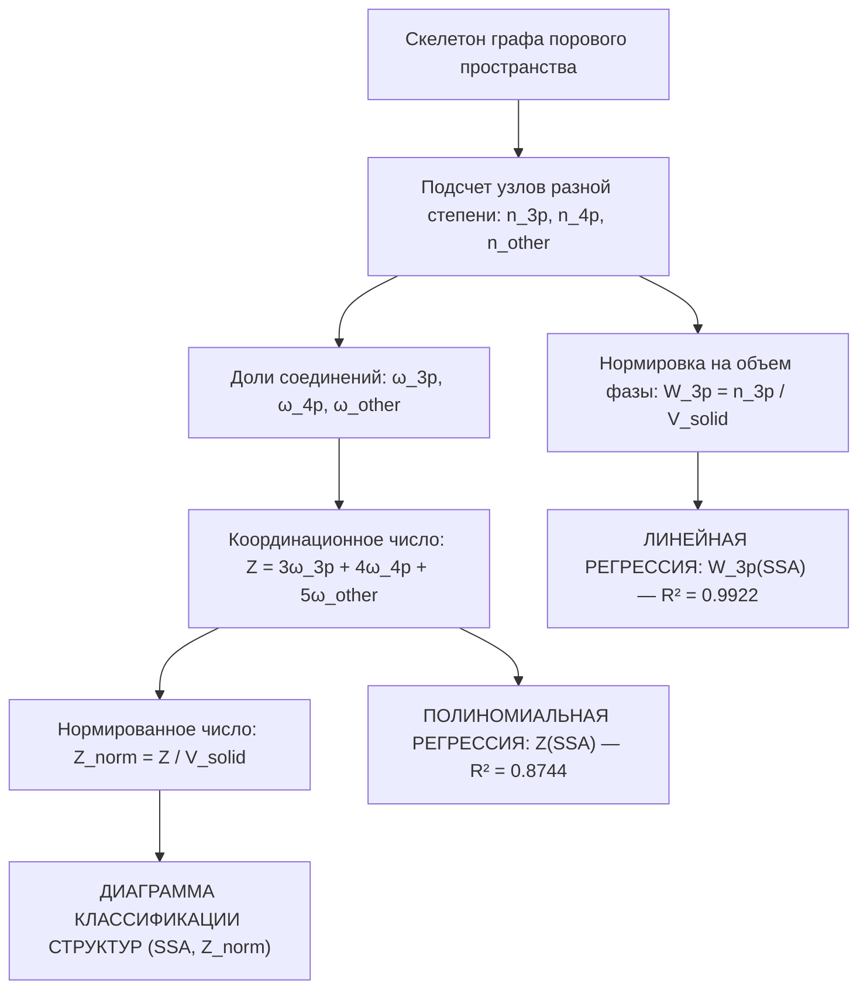

# Анализ узлов ветвления и координационных чисел скелетона

Связность и топологическая сложность трехмерной поровой сети определяются плотностью узлов ветвления и их координационным числом (числом каналов, сходящихся в одной точке сочленения). 

В исследовании Ю.Ю. Пилипенко выполнен детальный анализ взаимосвязи между плотностью узлов скелетона, средним координационным числом $Z$ и удельной площадью поверхности (SSA).

---

## 1. Корреляция гистерезисов сорбции и тройных соединений

Теоретической предпосылкой послужили работы по исследованию жидкостей в реконструированном мезопористом кремнеземе (Svidrytski et al., *Langmuir* 2018). При численном моделировании процессов сорбции было обнаружено, что среди множества структурных характеристик только две демонстрируют ярко выраженные гистерезисные петли идентичной геометрической формы:
- интегральная удельная площадь поверхности (SSA),
- количество тройных соединений ветвей скелетона ($n_{3p}$).

Расчет коэффициентов взаимной корреляции между изотермами адсорбции/десорбции SSA и $n_{3p}$ показал исключительно высокие значения:
$$r_{ads} = 0.9907 \quad (\text{для ветви адсорбции})$$
$$r_{des} = 0.9903 \quad (\text{для ветви десорбции})$$

Это послужило основанием для детального исследования связи между узлами ветвления и удельной площадью поверхности.

---

## 2. Нормированное количество тройных соединений ($W_{3p}$)

Поскольку абсолютное число тройных узлов $n_{3p}$ зависит от физического размера исследуемой цифровой реконструкции, вводится нормированная характеристика — объемная плотность тройных соединений на единицу объема твердой фазы:

$$W_{3p} = \frac{n_{3p}}{V_{solid}} \quad [\text{м}^{-3}] \quad (3.7)$$
где:
- $n_{3p}$ — суммарное количество тройных узлов (соединений степени 3) в скелетоне,
- $V_{solid}$ — физический объем твердой фазы кремниевой матрицы (рассчитанный методом Marching Cubes или прямым подсчетом).

### Главный экспериментальный результат:
При сопоставлении величины $W_{3p}$ с удельной площадью поверхности SSA для исследуемых структур (`Coreshell16`, `Coreshell9`, `Si26`, `Si21`, `Si12`, `SBA15`, `KIT6`) обнаружена **строжайшая линейная функциональная зависимость**:

$$W_{3p} = k \cdot SSA + b$$
Коэффициент детерминации линейной регрессии составил:
$$R^2 = 0.9922$$

> [!IMPORTANT] Физический смысл открытой закономерности
> Удельная площадь поверхности мезопористого материала прямо пропорциональна пространственной плотности тройных узловых соединений поровых каналов. Это открывает возможность прямого расчетного восстановления плотности поровой сети по макроскопическим данным сорбционных изотерм.

---

## 3. Расчет среднего координационного числа ветвления ($Z$)

Для оценки средней связности графа вычисляются доли узлов различной кратности относительно общего числа соединений $N = n_{3p} + n_{4p} + n_{other}$:

$$\omega_{3p} = \frac{n_{3p}}{N} \quad (3.8)$$
$$\omega_{4p} = \frac{n_{4p}}{N} \quad (3.9)$$
$$\omega_{other} = \frac{n_{other}}{N} \quad (3.10)$$

Среднее координационное число ветвления скелетона рассчитывается как математическое ожидание валентности узлов:
$$Z = 3 \cdot \omega_{3p} + 4 \cdot \omega_{4p} + 5 \cdot \omega_{other} \quad (3.11)$$

Нормированное координационное число:
$$Z_{norm} = \frac{Z}{V_{solid}} \quad (3.12)$$

### Зависимость $Z$ от SSA:
График зависимости $Z(SSA)$ напоминает ветвь логарифма:
- Аппроксимация полиномом 3-й степени дает коэффициент детерминации:
  $$R^2 = 0.8744$$
- Логарифмическая аппроксимация дает:
  $$R^2 = 0.8436$$

---

## 4. Морфологическая классификация структур по $(SSA, Z_{norm})$

При анализе плоскости параметров $(SSA, Z_{norm})$ выявлено фундаментальное пространственное разделение типов пористой геометрии:
- Все образцы со **стохастической (неупорядоченной)** структурой пор (`Si12`, `Si21`, `Si26`, `Coreshell9`, `Coreshell16`) формируют плотный кластер в левом нижнем секторе графика с низкими значениями $Z_{norm}$.
- Образцы с **упорядоченной (кристаллоподобной)** структурой каналов (`SBA15` с гексагональными каналами и `KIT6` с кубической гироидной сетью) резко смещены в правый верхний сектор диаграммы за счет высокого отношения связности к объему.

Это позволяет использовать фазовое пространство $(SSA, Z_{norm})$ как инструмент для экспресс-классификации морфологического типа пористых сред.

---

## Программные модули в репозитории
- `src/Skeleton_junctions.py` — расчет $n_{3p}$, $V_{solid}$ и нормированной величины $W_{3p}$.
- `src/Skeleton_Z.py` — расчет долей узлов $\omega$, координационного числа $Z$ и $Z_{norm}$.
- `src/Relationship_between_Z_and_SSA.py` — корреляционный анализ сорбционных гистерезисов.

---
**Связанные разделы базы знаний:**
- [[Index|Карта содержания]]
- [[методы/Скелетонизация_и_анализ_графов_ImageJ|Скелетонизация в ImageJ]]
- [[методы/Анализ_кривизны_ветвей_скелетона|Анализ кривизны ветвей]]
- [[03_Глава_3_Анализ_результатов_и_взаимосвязи_морфологии|Глава 3. Результаты и регрессионные модели]]
