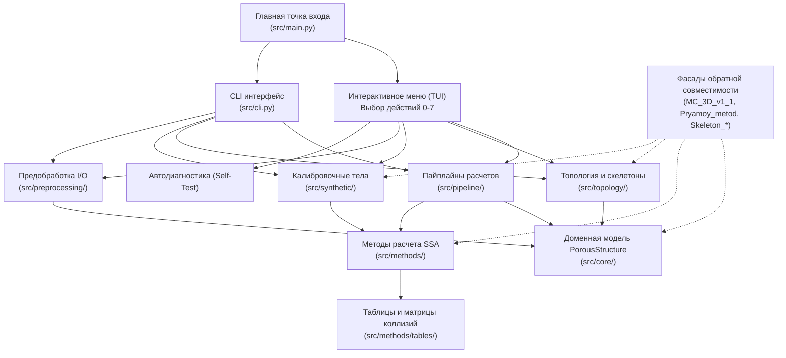
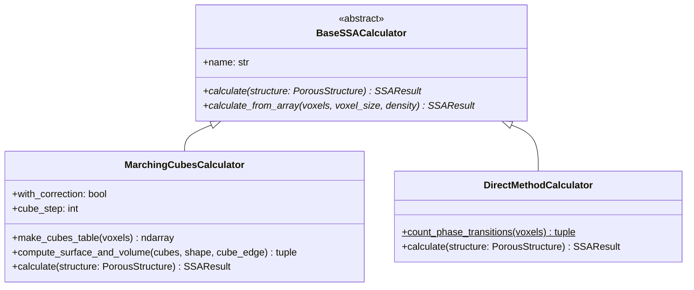

# Архитектура программного комплекса (ООП и CLI)

В рамках модернизации программного обеспечения магистерской диссертации Ю.Ю. Пилипенко выполнена полная реорганизация разрозненных процедурных скриптов в объектно-ориентированную модульную систему с сохранением 100% обратной совместимости через фасадные обертки.

---

## 🏛️ Концептуальная архитектура

Программный комплекс разделен на 6 предметных пакетов, каждый из которых отвечает за свой уровень абстракции:



---

## 📦 Пакеты и классы

### 1. Доменная модель (`src/core/`)
- **[structure.py](file:///F:/Projects/project_master/src/core/structure.py)** — класс `PorousStructure`:
  - **Назначение:** Представление 3D воксельного массива пористой среды с метаданными.
  - **Свойства:** `voxels` (uint8/bool 3D), `shape`, `porosity` ($\phi = 1 - N_{solid}/N_{total}$), `solid_volume_m3`, `solid_mass_g`, `voxel_size` ($h$), `density` ($\rho = 2.12 \times 10^6 \text{ г/м}^3$).
  - **Фабричные методы:**
    - `load(name)` — автозагрузка из кэша `.npy` или стека изображений `data/structures/<name>`.
    - `from_images(folder, threshold, invert)` — сборка массива из стека TIFF/PNG.
    - `from_cache(path)` — быстрая загрузка из скомпилированного массива.
  - **Методы экземпляра:**
    - `extract_subvolume(origin, size)` — извлечение суб-объема для 3D визуализации.
    - `export_slices(output_dir)` — экспорт послойных изображений для ImageJ / 3D Viewer.

### 2. Методы расчета SSA (`src/methods/`)
- **[base.py](file:///F:/Projects/project_master/src/methods/base.py)**:
  - `BaseSSACalculator` — абстрактный интерфейс с методами `calculate(structure)` и `calculate_from_array(voxels, voxel_size, density)`.
  - `SSAResult` — dataclass результатов: `ssa_m2_g`, `surface_area_m2`, `solid_volume_m3`, `porosity`, `relative_error_pct`, `execution_time_sec`.
- **[marching_cubes.py](file:///F:/Projects/project_master/src/methods/marching_cubes.py)** — класс `MarchingCubesCalculator`:
  - Реализует классический и модифицированный (авторский) методы Marching Cubes.
  - Параметр `with_correction=True` подключает $16 \times 16$ матрицы граничных поправок ($M_0, M_1, M_2$).
  - Параметр `cube_step=2` задает шаг дискретизации ячеек ($A = 2h$).
- **[direct_method.py](file:///F:/Projects/project_master/src/methods/direct_method.py)** — класс `DirectMethodCalculator`:
  - Векторизованный подсчет межфазных переходов $N_S$ вдоль трех декартовых осей Z, X, Y:
    $$\text{SSA} = \frac{N_S}{\rho \cdot h \cdot N_V}$$
- **[tables/mc_tables.py](file:///F:/Projects/project_master/src/methods/tables/mc_tables.py)**:
  - Предрассчитанные массивы для 256 конфигураций `BASE_TABLE_S`, `BASE_TABLE_V` и матрицы коллизий `CORRECTION_M0`, `CORRECTION_M1`, `CORRECTION_M2`.



---

### 3. Топологический анализ (`src/topology/`)
- **[skeleton_analyzer.py](file:///F:/Projects/project_master/src/topology/skeleton_analyzer.py)** — класс `SkeletonAnalyzer`:
  - `calculate_tortuosity(structure_name, min_branches=500)` — расчет средней геометрической извилистости ветвей $\tau = \frac{d_{branch}}{d_{euclid}}$.
  - `calculate_coordination(structure_name)` — расчет среднего координационного числа ветвления $Z = 3\omega_{3p} + 4\omega_{4p} + 5\omega_{other}$.
  - `calculate_triple_points_density(structure_name)` — нормированная объемная плотность тройных узлов $W_{3p} = \frac{n_{3p}}{V_{solid}}$.
- **[sorption.py](file:///F:/Projects/project_master/src/topology/sorption.py)** — класс `SorptionCorrelationAnalyzer`:
  - Разделение сорбционных кривых на ветви адсорбции и десорбции.
  - Расчет коэффициента корреляции Пирсона между удельной площадью поверхности SSA и плотностью тройных соединений ветвей скелетона.

### 4. Синтетическая геометрия и калибровка (`src/synthetic/`)
- **[shapes.py](file:///F:/Projects/project_master/src/synthetic/shapes.py)**:
  - `BaseSyntheticShape` — базовый класс с аналитическими решениями для $S, V, \text{SSA}$.
  - `SyntheticSphere` — сфера диаметра $D$ с точным $\text{SSA}_{exact} = \frac{6}{\rho D}$.
  - `SyntheticCylinder` — цилиндр диаметра $D$ и длины $L$ с $\text{SSA}_{exact} = \frac{2}{\rho} (\frac{1}{R} + \frac{1}{L})$.
- **[benchmark.py](file:///F:/Projects/project_master/src/synthetic/benchmark.py)** — класс `CalibrationBenchmark`:
  - Проведение сеточных тестов погрешности Marching Cubes и прямого метода в зависимости от разрешения сетки и размера тел.

### 5. Предобработка данных (`src/preprocessing/`)
- **[threshold.py](file:///F:/Projects/project_master/src/preprocessing/threshold.py)** — класс `ThresholdFinder`:
  - Поиск порога бинаризации, минимизирующего невязку пористости $\min | \phi_{calc}(T) - \phi_{nom} |$.
  - Алгоритм Оцу для автоматического разделения фаз.
- **[rescale.py](file:///F:/Projects/project_master/src/preprocessing/rescale.py)** — класс `VolumeRescaler`:
  - Бикубическое сжатие стеков микрофотографий с коэффициентами $k \in [0.70, 0.95]$.

### 6. Конвейер анализа (`src/pipeline/`)
- **[ssa_pipeline.py](file:///F:/Projects/project_master/src/pipeline/ssa_pipeline.py)** — класс `SSAEvaluationPipeline`:
  - Полный цикл исследования 7 структур:
    1. Загрузка вокселей (`PorousStructure.load`).
    2. Расчет модифицированным MC (`MarchingCubesCalculator(with_correction=True)`).
    3. Расчет классическим MC (`MarchingCubesCalculator(with_correction=False)`).
    4. Расчет прямым методом (`DirectMethodCalculator`).
    5. Вычисление относительных погрешностей $\Delta_{MC}, \Delta_{DM}$ относительно экспериментального БЭТ.
    6. Экспорт сводной таблицы в CSV и pickle.

---

## 🎮 Интерактивное меню управления (`src/main.py`)

Для работы без запоминания флагов и параметров командной строки разработан интерактивный терминальный интерфейс с многоуровневым меню выбора действий:

```bash
python src/main.py
```

После запуска пользователю предоставляется меню:
```text
╔══════════════════════════════════════════════════════════════════════════════════╗
║   КОМПЛЕКС АНАЛИЗА МОРФОЛОГИИ ПОРИСТЫХ СРЕД И ВЫЧИСЛЕНИЯ УДЕЛЬНОЙ ПЛОЩАДИ (SSA)  ║
║   Магистерская диссертация Ю.Ю. Пилипенко (БГУ, РФКТ, САиКМ, 2021)               ║
╚══════════════════════════════════════════════════════════════════════════════════╝

  ГЛАВНОЕ МЕНЮ:
  ──────────────────────────────────────────────────────────────────────────
  [1] 📊 Расчет удельной площади поверхности (SSA: Marching Cubes & PM)
  [2] 🧬 Топологический анализ скелетонов (извилистость τ, узлы Z, W_3p)
  [3] 🎯 Калибровочные тесты на аналитических телах (сфера и цилиндр)
  [4] 📈 Сорбционный анализ и корреляция петель гистерезиса
  [5] 🔬 Предобработка томографических данных (порог пористости, Оцу, рескейл)
  [6] 🧊 Экспорт суб-объема для 3D визуализации (ImageJ 3D Viewer)
  [7] 🧪 Автоматическое самотестирование комплекса (Self-Test)
  ──────────────────────────────────────────────────────────────────────────
  [0] 🚪 Выход из программы
```

Каждый раздел содержит подменю с выбором исследуемой структуры как из базовых 7 (`Si12`, `Si21`, `Si26`, `SBA15`, `KIT6`, `Coreshell9`, `Coreshell16`), так и из масштабных серий $k \in \{0.70, 0.75, 0.80, 0.85, 0.90, 0.95\}$ (всего 49 вариантов), параметров и автоматическим построением графиков сходимости.

---

## 💻 Консольный режим CLI (`src/main.py` / `src/cli.py`)

Если при запуске переданы аргументы командной строки, программа автоматически переключается в режим CLI:

```bash
# 1. Расчет удельной площади поверхности для структуры Si12 (базовой или масштабированной):
python src/cli.py ssa --structure Si12
python src/cli.py ssa --structure Si12-0.7

# 2. Исследование сеточной сходимости по всем масштабам k in [0.70 .. 1.00] с построением графика:
python src/cli.py ssa --structure Si12 --scale-series --save

# 3. Пакетный расчет всех 7 базовых структур с сохранением результатов:
python src/cli.py ssa --save

# 3. Топологический паспорт скелетонов (τ, Z, W_3p):
python src/cli.py skeleton

# 4. Аналитическое тестирование на синтетических телах:
python src/cli.py benchmark --shape sphere --dmin 4 --dmax 24 --step 4

# 5. Анализ гистерезиса сорбции:
python src/cli.py sorption

# 6. Подбор порога бинаризации:
python src/cli.py porosity --structure SBA15 --scale 0.85

# 7. Извлечение суб-объема для 3D просмотра:
python src/cli.py subvolume --structure Coreshell9 --size 100
```

---

## 🔄 Карта соответствия историческим скриптам

Для обеспечения 100% обратной совместимости старые скрипты сохранены в корне `src/` как фасадные функции:

| Исходный скрипт в `src/` | Делегирует в класс ООП | Основной метод / свойство |
| :--- | :--- | :--- |
| `MC_3D_v1_1.py` | `methods.marching_cubes.MarchingCubesCalculator` | `compute_surface_and_volume`, `make_cubes_table` |
| `Pryamoy_metod.py` | `methods.direct_method.DirectMethodCalculator` | `count_phase_transitions`, `calculate` |
| `Formirovanie_massiva_v1.py` | `core.structure.PorousStructure` | `PorousStructure.load(name).voxels` |
| `MC_SSA_for_porous_structures.py` | `pipeline.ssa_pipeline.SSAEvaluationPipeline` | `run_all()` |
| `Skeleton_tau.py` | `topology.skeleton_analyzer.SkeletonAnalyzer` | `calculate_all_tortuosity()` |
| `Skeleton_Z.py` | `topology.skeleton_analyzer.SkeletonAnalyzer` | `calculate_all_coordination()` |
| `Skeleton_junctions.py` | `topology.skeleton_analyzer.SkeletonAnalyzer` | `calculate_all_triple_points_density()` |
| `Gener_sfer.py` | `synthetic.shapes.SyntheticSphere` | `SyntheticSphere(N).generate()` |
| `Gener_cylinder.py` | `synthetic.shapes.SyntheticCylinder` | `SyntheticCylinder(N, h).generate()` |
| `Test_algoritmov_v1.py` | `synthetic.benchmark.CalibrationBenchmark` | `run_sphere_benchmark()`, `run_cylinder_benchmark()` |
| `Relationship_between_Z_and_SSA.py`| `topology.sorption.SorptionCorrelationAnalyzer`| `analyze_hysteresis()` |
| `Proportion.py` | `core.structure.PorousStructure` | `struct.porosity` |
| `Opredelenie_poroga.py` | `preprocessing.threshold.ThresholdFinder` | `find_threshold_for_structure()` |
| `Rescale_v1.py` | `preprocessing.rescale.VolumeRescaler` | `batch_rescale_structure()` |
| `For_3D_Viewer.py` | `core.structure.PorousStructure` | `extract_subvolume()`, `export_slices()` |
