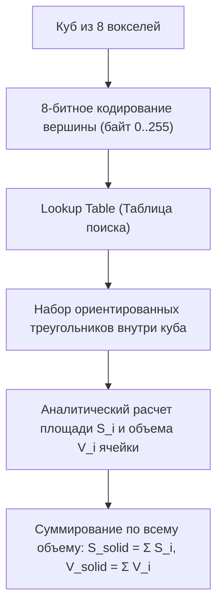

# Метод Marching Cubes (Шагающие кубы)

**Marching Cubes** — классический алгоритм компьютерной трехмерной графики, разработанный Уильямом Лоренсеном и Харви Клайном (1987) для триангуляции и полигональной реконструкции изоповерхностей в трехмерных дискретных скалярных полях.

В рамках магистерской диссертации алгоритм адаптирован для решения физической задачи: **точного расчета удельной площади поверхности (Specific Surface Area, SSA) и объема твердой фазы нанопористых материалов по воксельным данным**.

---

## Математическая и алгоритмическая концепция

Трехмерная расчетная область покрывается регулярной сеткой элементарных кубических ячеек, вершины которых совпадают с центрами вокселей. Каждый куб образован 8 вершинами:

$$\mathbf{V} = \{v_0, v_1, v_2, v_3, v_4, v_5, v_6, v_7\}$$

Поскольку данные бинаризированы ($v_k \in \{0, 1\}$, где 0 — пора/пустота, 1 — твердое тело), общее число возможных состояний ячейки равно:
$$2^8 = 256 \text{ конфигураций}$$

### 1. 8-битное кодирование куба
Каждой элементарной ячейке сопоставляется 8-битный числовой вектор (байт):
$$\text{Index} = \sum_{k=0}^7 v_k \cdot 2^k \in [0, 255]$$

Этот индекс служит прямым указателем в предварительно рассчитанную таблицу поиска (**Lookup Table**).

### 2. Таблица поиска (Lookup Table)
Для каждого из 256 случаев в таблице зафиксированы:
- Координаты точек пересечения изоповерхности с 12 ребрами куба (принимаются середины ребер ввиду бинарности поля).
- Топология формируемых треугольников (от 0 до 5 треугольников на ячейку).
- Аналитическая площадь треугольников $S_i$ внутри данного куба.
- Объем твердой фазы $V_i$, отсекаемый полигонами внутри ячейки.

### 3. Расчет удельной площади поверхности (SSA)
Результирующая удельная площадь поверхности вычисляется по формуле:
$$SSA_{MC} = \frac{S_{solid}}{m_{solid}} = \frac{\sum_{i=1}^n S_i}{\rho \cdot \sum_{i=1}^n V_i} \quad [\text{м}^2/\text{г}]$$
где:
- $\rho = 2.12 \times 10^6 \text{ г/м}^3 = 2.12 \text{ г/см}^3$ — плотность оксида кремния,
- $S_i$ и $V_i$ переведены в физические единицы ($\text{м}^2$ и $\text{м}^3$) с учетом физического размера вокселя $a$ (в метрах).

---

## Преимущества метода для нанопористых сред
1. **Сглаживание ступенчатых воксельных артефактов:** в отличие от воксельных ступеней, полигональная изоповерхность Marching Cubes естественным образом повторяет физическую кривизну мезопор (диаметром 2–50 нм).
2. **Точность при наклонах границы:** алгоритм устраняет геометрическое завышение площади на наклонных плоскостях, свойственное прямому методу (где погрешность манхэттенской аппроксимации диагонали достигает $\sqrt{2} - 1 \approx 41.4\%$, а диагонали куба $\sqrt{3} - 1 \approx 73.2\%$).
3. **Устойчивость к масштабированию:** сохраняет стабильность при огрублении пространственной сетки.

---

## Ограничение базового алгоритма и необходимость модификации
Стандартный алгоритм Marching Cubes не разрабатывался для метрологии площадей и игнорирует нестыковки треугольников на смежных гранях двух соседних ячеек в дискретном бинарном поле.
Для устранения этих ошибок разработана специальная надстройка:
👉 См. детально: **[[методы/Модификация_Marching_Cubes_учет_потерь|Модификация Marching Cubes: учет граничных потерь]]**.

---

## Реализация в проекте
- Модуль: `src/MC_3D_v1_1.py`
  - Функция `MakeTable_v1_1(objekt)`: разбиение 3D массива на кубы и вычисление индексов.
  - Функция `LookupTable_v1_1(A1)`: генерация расчетной таблицы геометрии ячеек.
  - Функция `ChTypeAndReturnSSA_v1_1(cubes, Table, A1, shape)`: итоговый расчет площади и SSA.

---
**Связанные разделы базы знаний:**
- [[Index|Карта содержания]]
- [[02_Глава_2_Разработка_и_реализация_алгоритмов_расчета_SSA|Глава 2. Разработка алгоритмов]]
- [[методы/Модификация_Marching_Cubes_учет_потерь|Модификация: учет потерь на гранях]]
- [[методы/Прямой_метод_расчета_SSA|Сравнение: Прямой воксельный метод]]
- [[03_Глава_3_Анализ_результатов_и_взаимосвязи_морфологии|Глава 3. Результаты тестов на сфере и пористых средах]]
