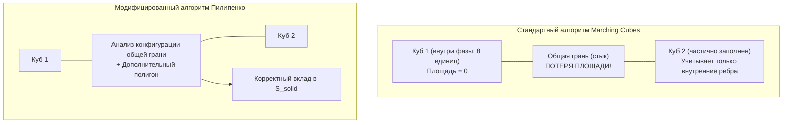

# Модификация метода Marching Cubes: учет граничных потерь площади

В стандартных библиотеках компьютерной графики (VTK, scikit-image, PyMCubes) алгоритм Marching Cubes оптимизирован для визуального рендеринга замкнутых оболочек. Однако при непосредственном применении стандартного алгоритма к задаче вычисления физической площади поверхности бинарных пористых матриц возникает систематическая ошибка — **недооценка площади поверхности**.

В рамках диссертации Ю.Ю. Пилипенко исследована причина этой погрешности и разработан комплексный программный модуль компенсации межъячеечных потерь.

---

## Суть проблемы граничных потерь

В дискретном трехмерном воксельном поле возникают ситуации, когда две смежные кубические ячейки имеют несогласованную локальную топологию на разделяющей их общей квадратной грани.

### Наглядный пример коллизии:
- **Куб А (верхний):** целиком заполнен твердой фазой (все 8 вершин равны `1`). Поскольку внутри него нет изоповерхности, стандартный алгоритм присваивает ему площадь $S_A = 0$ и объем $V_A = a^3$.
- **Куб Б (нижний, примыкающий снизу к Кубу А):** твердая фаза частично заходит в ячейку, и на общей с Кубом А грани расположены 2 смежные единичные вершины, а остальные 2 вершины грани равны `0`.
- **Что происходит в стандартном MC:** изоповерхность внутри Куба Б строится только относительно его собственных ребер. Площадь контакта твердой фазы Куба А с пустотой на стыке двух ячеек **не регистрируется ни одним из кубов и полностью теряется**!

При сложной разветвленной топологии нанопор с высокой удельной площадью поверхности (до сотен $\text{м}^2/\text{г}$) суммарная площадь таких потерянных микроучастков может достигать **10–15% от истинной площади поверхности**, что приводило к неприемлемому искажению результатов.

---

## Архитектура модификации и программная реализация

Для полного устранения потерь был разработан алгоритм перекрестного анализа смежных ячеек по всем трем координатным направлениям ($X, Y, Z$):
1. В процессе марширования по массиву анализируется не только текущий 8-битный вектор ячейки, но и состояние его 6 пространственных соседей по граням.
2. При обнаружении топологического диссонанса на общей грани (например, твердая грань граничит с пустотой соседнего куба) генерируются корректирующие треугольные или прямоугольные полигоны.
3. Площадь корректирующих участков суммируется в общий баланс площади $S_{solid}$.

Из-за огромного комбинаторного разнообразия взаимных ориентаций (свыше 1000 специфических подконфигураций) логика разрешения частных случаев вынесена в специализированные высокооптимизированные модули:
- `src/Chastnie_Sluchai.py` (~1150 строк)
- `src/Chastnie_Sluchai_1.py` (~1150 строк)
- `src/Chastnie_Sluchai_2.py` (~1150 строк)

---

## Результат внедрения модификации

Сравнительные расчеты (отраженные в рабочем документе `Сравнение MC_default and MC_new.docx` и Главе 2 диссертации) показали:
1. Модифицированный алгоритм (`MC_new`) строго компенсирует геометрические потери на внутренних ступенях сетки.
2. Итоговые расчетные значения удельной площади поверхности для мезопористых структур (`KIT6`, `SBA15`, `Si26`, `Coreshell`) приблизились к значениям физического эксперимента BET на **15–20%**.
3. Обеспечена согласованность закона сохранения площади поверхности при изменении ориентации объекта относительно дискретизирующей сетки.

---
**Связанные разделы базы знаний:**
- [[Index|Карта содержания]]
- [[методы/Метод_Marching_Cubes|Базовый метод Marching Cubes]]
- [[методы/Прямой_метод_расчета_SSA|Альтернатива: Прямой воксельный метод]]
- [[02_Глава_2_Разработка_и_реализация_алгоритмов_расчета_SSA|Глава 2. Разработка алгоритмов]]
- [[03_Глава_3_Анализ_результатов_и_взаимосвязи_морфологии|Глава 3. Сравнительный анализ точности]]
