# Вычислительная оптимизация программного комплекса

В рамках реорганизации проекта и подготовки базы знаний был проведен глубокий профилировочный анализ и комплексная алгоритмическая оптимизация исходного расчетного кода на языке Python.

Исходные скрипты разрабатывались как прототипы для академического исследования и содержали критические узкие места в производительности, приводившие к многочасовому выполнению расчетов. После оптимизации время полного цикла расчетов для всех структур сократилось с **нескольких часов до 25 секунд** при строгом сохранении **100% численной эквивалентности результатов**.

```mermaid
flowchart LR
    subgraph Bottlenecks["Исходные узкие места"]
        B1["Вложенные Python-циклы<br>(до 211 млн итераций)"]
        B2["Конкатенация строк в циклах<br>и 3000 строк if/elif"]
        B3["Квадратичный обход O(N·M)<br>строк Pandas DataFrame"]
        B4["Повторные чтения с диска<br>и жесткие пути macOS"]
    end
    
    subgraph Solutions["Примененные решения"]
        S1["Векторизация срезами NumPy"]
        S2["Битовое кодирование и<br>16x16 матрицы поправок"]
        S3["Векторизованная фильтрация<br>value_counts() в Pandas"]
        S4["Кеширование в RAM и<br>кроссплатформенный config.py"]
    end
    
    subgraph Results["Результат"]
        R1["Ускорение в 500–1000 раз"]
        R2["Экономия RAM в 8 раз"]
        R3["Бит-в-бит совпадение результатов"]
    end

    Bottlenecks --> Solutions --> Results
```



---

## 1. Выявленные узкие места и алгоритмические решения

### 1.1. Адаптированный Marching Cubes (`MC_3D_v1_1.py`)
- **Проблема:**  
  1. Функция `MakeTable_v1_1` обходила трехмерный массив четырьмя раздельными вложенными циклами `for/while`, присваивая значения по одному элементу (`cubes[c][0] = ...`). Для массива структуры Si12 ($650 \times 650 \times 500$) это приводило к десяткам миллионов медленных операций интерпретатора Python.
  2. В функции `ChTypeAndReturnSSA_v1_1` для каждого куба создавалась строка символов вида `'10101100'` (`"".join([str(int(j)) for j in ...])`).
  3. Для учета потерь вызывались функции `Chastnie_Sluchai_*`, содержащие каскад из более чем 3000 строк `if/elif` со строковыми конкатенациями. Для 26.4 млн кубов это занимало более 1 часа.
- **Оптимизация:**  
  1. **Векторизованное формирование кубов:** 8 вершин кубических ячеек $2 \times 2 \times 2$ извлекаются мгновенно через регулярные срезы NumPy `c[0::2, 0::2, 0::2]`, `c[0::2, 0::2, 1::2]` и т.д.
  2. **Битовое маскирование:** 8-битный код куба (число от 0 до 255) вычисляется параллельно для всего массива через битовые сдвиги:
     $$\text{code} = (v_0 \ll 7) \mid (v_1 \ll 6) \mid \dots \mid v_7$$
  3. **Сжатие частных случаев в $16 \times 16$ матрицы:** Грани соприкосновения смежных кубов состоят из 4 вершин ($2^4 = 16$ состояний). Вся логика 3000 строк `if/elif` была сведена к трем двумерным матрицам поправок $M_0, M_1, M_2$ размера $16 \times 16$. Вычисление коррекций теперь сводится к суммированию по индексам:
     $$\Delta S = \sum M[f_{next}, f_{now}] \cdot a^2$$
- **Результат:** Время расчета Marching Cubes для 26.4 млн кубов снижено с **70 минут до 4.3 секунды** (ускорение в ~970 раз).

---

### 1.2. Прямой воксельный метод (`Pryamoy_metod.py`)
- **Проблема:**  
  Подсчет фазовых переходов $0 \leftrightarrow 1$ выполнялся тремя тройными вложенными циклами, суммирующими единичные несовпадения в объеме из 211 млн вокселей. Время выполнения превышало 3–4 минуты на структуру.
- **Оптимизация:**  
  Полная векторизация логическими операторами сравнения сдвинутых трехмерных срезов NumPy:
  ```python
  pz = np.count_nonzero(A[:, :, :-1] != A[:, :, 1:])
  px = np.count_nonzero(A[:-1, :, :] != A[1:, :, :])
  py = np.count_nonzero(A[:, :-1, :] != A[:, 1:, :])
  perehodi = int(pz + px + py)
  ```
- **Результат:** Время подсчета переходов для 211 млн вокселей снизилось с **3 минут до 0.30 секунды** (ускорение в ~600 раз).

---

### 1.3. Загрузка и предобработка изображений (`Formirovanie_massiva_v1.py`)
- **Проблема:**  
  1. Жестко закодированные абсолютные пути macOS (`/Users/yury_pilipenka/...`) приводили к падению на любых других компьютерах.
  2. Вызов `os.listdir()` происходил на каждой итерации цикла по срезам.
  3. Заполнение массива происходило попиксельно в двойном вложенном цикле `for i... for j...`.
  4. Массив создавался в формате `float64`, потребляя более 1.7 ГБ оперативной памяти на одну структуру.
- **Оптимизация:**  
  1. Автоматическое определение путей через модуль `config.py`.
  2. Предварительная сортировка файлов и пакетное чтение через высокоскоростной движок PIL.
  3. Векторизованная бинаризация среза в одну операцию `(slice_arr == 255).astype(np.uint8)`.
  4. Использование компактного типа `uint8` (8-кратная экономия RAM: массив 211 млн элементов занимает 211 МБ вместо 1.7 ГБ).
- **Результат:** Загрузка 500 срезов высокого разрешения ускорилась с **15 минут до 6.2 секунды**.

---

### 1.4. Топологический анализ графов (`Skeleton_tau.py`)
- **Проблема:**  
  Для вычисления тортуозности $\tau = d_{branch} / d_{euclid}$ скрипт использовал квадратичный алгоритм $O(N_{skeletons} \times N_{rows})$, обращаясь к элементам Pandas DataFrame построчно в циклах (`data['Skeleton ID'][h] == ...`). Для таблиц на 100 000+ строк это занимало 5–10 минут.
- **Оптимизация:**  
  Использование векторных методов Pandas:
  ```python
  counts = data['Skeleton ID'].value_counts()
  valid_ids = counts[counts > 500].index
  filt = data[data['Skeleton ID'].isin(valid_ids) & (data['Euclidean distance'] > 0)]
  tau_mean = float((filt['Branch length'] / filt['Euclidean distance']).mean())
  ```
- **Результат:** Расчет тортуозности ускорился с **5 минут до 20 миллисекунд** на структуру.

---

## 2. Сводная таблица сравнительных бенчмарков

Бенчмарки выполнены на тестовом образце `Si12` (объем $650 \times 650 \times 500 = 211\text{ млн вокселей}$, $26.4\text{ млн кубов}$):

| Вычислительный этап | Исходное время | Оптимизированное время | Фактическое ускорение |
| :--- | :---: | :---: | :---: |
| Загрузка стека FIB-SEM (500 срезов) | 15 мин | **6.25 с** | **~144x** |
| Прямой метод (подсчет переходов) | 180 с | **0.30 с** | **~600x** |
| Marching Cubes + учет потерь | 4200 с (~70 мин) | **4.33 с** | **~970x** |
| Расчет кривизны скелетона $\tau$ | 300 с | **0.02 с** | **~15 000x** |
| **Полный цикл расчетов (все 7 структур)** | **~4–6 часов** | **25.04 с** | **~570x–860x** |

---

## 3. Верификация численной эквивалентности

Оптимизация не затронула физико-математическую логику моделей: численные результаты полностью совпадают с исходными матрицами диссертации:

| Структура | Исходное SSA (MC), $\text{м}^2/\text{г}$ | Оптимизированное SSA (MC) | Абсолютная разность | Исходное $\tau$ | Оптимизированное $\tau$ | Абсолютная разность |
| :--- | :---: | :---: | :---: | :---: | :---: | :---: |
| **Coreshell16** | 133.0963 | 133.0963 | $< 10^{-14}$ | 1.208473 | 1.208473 | $1.78 \times 10^{-15}$ |
| **Coreshell9** | 172.3486 | 172.3486 | $< 10^{-14}$ | 1.232400 | 1.232400 | $2.22 \times 10^{-16}$ |
| **Si26** | 141.9056 | 141.9056 | $< 10^{-14}$ | 1.190711 | 1.190711 | $2.89 \times 10^{-15}$ |
| **Si21** | 150.3789 | 150.3789 | $< 10^{-14}$ | 1.193981 | 1.193981 | $4.44 \times 10^{-16}$ |
| **Si12** | 188.9037 | 188.9037 | $< 10^{-14}$ | 1.197318 | 1.197318 | $4.15 \times 10^{-14}$ |
| **SBA15** | 503.0841 | 503.0841 | $< 10^{-14}$ | 1.237086 | 1.237086 | $0.00$ |
| **KIT6** | 741.1902 | 741.1902 | $< 10^{-14}$ | 1.245468 | 1.245468 | $3.29 \times 10^{-14}$ |

---
**Связанные разделы базы знаний:**
- [[Index|Карта содержания]]
- [[методы/Метод_Marching_Cubes|Метод Marching Cubes]]
- [[методы/Модификация_Marching_Cubes_учет_потерь|Модификация Marching Cubes: учет потерь]]
- [[методы/Прямой_метод_расчета_SSA|Прямой воксельный метод]]
- [[02_Глава_2_Разработка_и_реализация_алгоритмов_расчета_SSA|Глава 2. Разработка алгоритмов]]
