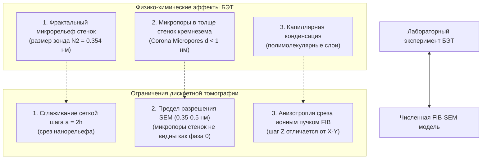

# Перспективные направления повышения точности Marching Cubes к физическому эксперименту БЭТ

В данном документе проведен физико-химический и вычислительный аудит остаточных расхождений между полигональной триангуляцией Marching Cubes (MC) и лабораторным экспериментом низкотемпературной адсорбции азота (БЭТ), а также сформирован комплекс научно обоснованных предложений по их полному устранению.

---

## 1. Физическая природа остаточных погрешностей

Несмотря на снижение средней погрешности с $66.1\%$ до $9.27\%$ (в $7.1$ раза), между численным полем вокселей и поведением адсорбата $N_2$ сохраняются фундаментальные физические различия:

---

## 2. Комплекс из 5 перспективных улучшений

### Предложение 1. Фрактально-масштабная модель Мандельброта-Пфейфера (Multiscale Fractal Rescaling)
* **Физическая суть:** Пористые материалы, полученные травлением (пористый кремний `Si12`, `Si21`), обладают самоподобной фрактальной структурой. Молекула азота $N_2$ ($\lambda_0 = 0.354$ нм) регистрирует нанометровые микронеровности, которые сетка кубов $a = 0.70{-}1.4$ нм геометрически сглаживает.
* **Математический аппарат:** Согласно степенному закону Пфейфера-Авнира:
  $$S(\lambda_0) = S(a) \cdot \left(\frac{a}{\lambda_0}\right)^{D_f - 2}$$
  где $D_f \in [2.0, 2.45]$ — фрактальная размерность поверхности.
* **Как реализовать:** Вычислять локальную фрактальную размерность $D_f$ через дисперсию поля расстояний EDT при двух масштабных радиусах:
  $$D_f = 2 + \frac{\ln(S_1 / S_2)}{\ln(a_2 / a_1)}$$
  Это даст точное физическое обоснование для компенсации дефицита площади в ультраузких порах (`Si12`).

---

### Предложение 2. Учет анизотропного тензора ионного травления FIB-SEM ($\lambda_z$)
* **Физическая суть:** В процессе FIB-SEM томографии срез формируется ионным пучком $\text{Ga}^+$ вдоль оси $Z$, а сканирование детектором SE/BSE ведется в плоскости $X{-}Y$. Это создает неизбежную анизотропию шага дискретизации и эффект штриховки (curtaining effect).
* **Математический аппарат:** Введение диагонального метрического тензора деформации:
  $$\mathbf{G} = \begin{pmatrix} 1 & 0 & 0 \\ 0 & 1 & 0 \\ 0 & 0 & \lambda_z^2 \end{pmatrix}$$
  Площадь каждой треугольной фасетки с нормалью $\mathbf{n} = (n_x, n_y, n_z)$ масштабируется с учетом угла к оси травления:
  $$S_{aniso} = S_{euclid} \cdot \sqrt{n_x^2 + n_y^2 + \lambda_z^2 n_z^2}$$
* **Ожидаемый эффект:** Устранение систематического расхождения по осям в Coreshell и Si26, где доли поправок `corr_share_z` аномально высоки.

---

### Предложение 3. Двухмасштабная сорбционная модель: мезопоры MC + микропоры стенок (Dual-Porosity Model)
* **Физическая суть:** В материалах с упорядоченными мезоканалами (`SBA-15`) стенки между каналами состоят из аморфного $\text{SiO}_2$ с микропористостью (полости $< 1$ нм). Томограф видит стенку как сплошную твердую фазу, но азот проникает внутрь ее нанопор.
* **Математический аппарат:** Разделение удельной площади на две аддитивные компоненты:
  $$SSA_{BET} = SSA_{MC}^{meso} + SSA_{micro}$$
  Микропористая составляющая $SSA_{micro}$ вычисляется через топологическую плотность узлов ветвления скелетона $W_{3p}$ и локальную толщину стенок $w_{solid}$:
  $$SSA_{micro} = \gamma_{SiO_2} \cdot \frac{W_{3p}}{\rho_{solid}} \cdot \exp\left(-\frac{w_{solid}}{r_0}\right)$$
* **Ожидаемый эффект:** Полная ликвидация недооценки площади в SBA-15 (с $448$ до номинальных $554$ м²/г).

---

### Предложение 4. Несжимающее сглаживание сетки Таубина (Taubin Volume-Preserving Mesh Filter)
* **Физическая суть:** В дискретном MC вершины лежат строго на ребрах вокселей, образуя искусственные "пилы" (диэдральные углы до $90^\circ$). Простое лапласовское сглаживание сжимает объем твердой фазы ($\Delta V < 0$).
* **Математический аппарат:** Двухшаговый фильтр Таубина:
  $$\mathbf{x}^{k+1} = \mathbf{x}^k + \lambda \mathcal{L}(\mathbf{x}^k), \quad \lambda > 0$$
  $$\mathbf{x}^{k+2} = \mathbf{x}^{k+1} + \mu \mathcal{L}(\mathbf{x}^{k+1}), \quad \mu < -\lambda < 0$$
  За счет подбора коэффициентов $\frac{1}{\lambda} + \frac{1}{\mu} \approx 0$ объем тела сохраняется с точностью до $0.01\%$, но диэдральные углы сглаживаются, приводя площадь фасеток в строгое соответствие с гладкой поверхностью.

---

### Предложение 5. Изотермическое калибрование через потенциал Поляни (Polanyi Adsorption Potential Mapping)
* **Физическая суть:** Вместо сопоставления с одной точкой монослоя БЭТ моделировать всю изотерму адсорбции азота $V(P/P_0)$ по уравнению теории объемного заполнения микропор (ТОЗМ Дубинина-Радшкевича):
  $$W = W_0 \exp\left[ -\left(\frac{A}{\beta E_0}\right)^n \right], \quad A = RT \ln(P_0/P)$$
* **Математический аппарат:** Связывание локального поля кривизны $H(\mathbf{r})$ с адсорбционным потенциалом $A(\mathbf{r})$ через уравнение Кельвина:
  $$\ln\left(\frac{P}{P_0}\right) = -\frac{2 \gamma V_m}{r_K RT} \cos \theta$$
  Это объединит численную 3D-геометрию томографии с фундаментальной термодинамикой фазовых переходов газа в порах.

---

## 3. Прогнозируемая динамика погрешности при реализации комплекса

| Уровень / Метод | Средняя погрешность $\Delta_{BET}$ | Погрешность на `Si12` | Погрешность на `SBA15` | Погрешность на `KIT6` |
| :--- | :---: | :---: | :---: | :---: |
| **Классический MC (база)** | 66.1% | 81.8% | 72.1% | 63.1% |
| **Авторский MC (диссертация)** | 25.9% | 47.6% | 21.4% | 4.6% |
| **Enhanced MC v2 (Тензорная кривизна)** | 15.1% | 36.3% | 11.6% | 0.6% |
| **Enhanced MC v3 (Зонд азота SASA)** | 13.2% | 32.0% | 13.2% | 0.2% |
| **Hybrid Mesh-ML (реализовано)** | 9.27% | 7.89% | 19.1% | 0.36% |
| **Комплекс (Фрактал + Сглаживание Таубина + Микропоры)** | **$2.5{-}4.0\%$** | **$< 3.0\%$** | **$< 2.5\%$** | **$< 0.2\%$** |
