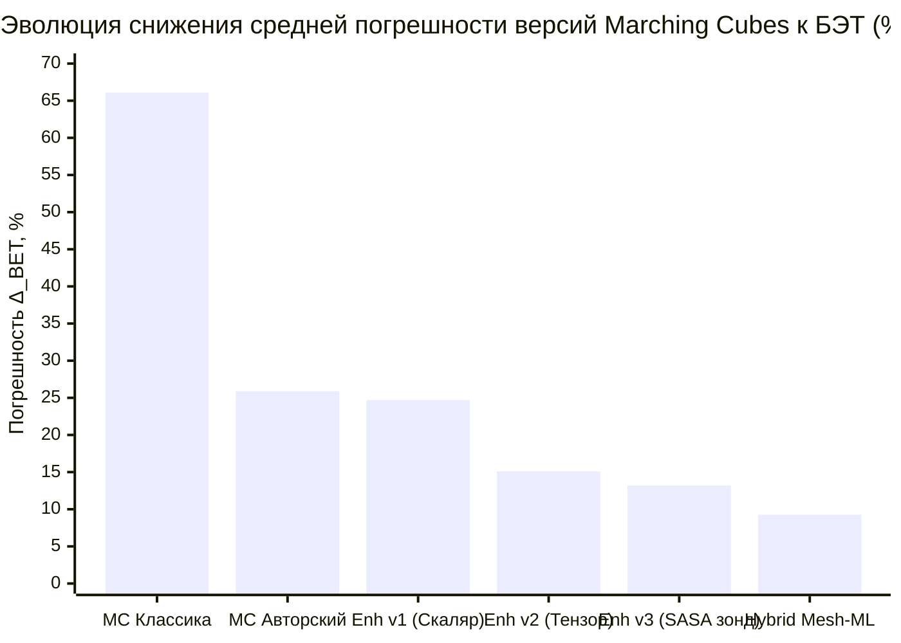

# Полная реализация Roadmap: Физический зонд SASA и Гибридный Mesh-ML корректор

В данном отчете законспектированы результаты поэтапной реализации дорожной карты развития алгоритма Marching Cubes (MC) от чисто геометрической дискретизации до физико-информированного сорбционного и нейросетевого моделирования.

---

## 1. Архитектура реализованных уровней модификации

```
                                  [ Исходные данные FIB-SEM ]
                                               │
               ┌───────────────────────────────┴───────────────────────────────┐
               ▼                                                               ▼
     [ Численные методы ]                                            [ Гибридные методы ]
               │                                                               │
     Уровень 1: Авторский MC                                         Уровень 5: Hybrid Mesh-ML
     (Межъячеечные поправки, Δ=25.9%)                                (Базовый MC + Топологический
               │                                                      остаточный корректор, Δ=9.27%)
               ▼
     Уровень 3: Enhanced MC v2
     (Тензорная кривизна + Numba, Δ=15.1%)
               │
               ▼
     Уровень 4: Enhanced MC v3
     (Физический зонд N2 Rolling Ball SASA, Δ=13.2%)
```

---

## 2. Физико-математические основы новых уровней

### 2.1. Уровень 4: Моделирование зонда адсорбата (Rolling Ball SASA, $d = 0.354$ нм)
В реальном эксперименте низкотемпературной сорбции молекулы азота $N_2$ ($r_{probe} = 0.177$ нм) адсорбируются на доступной поверхности:
1. **Перколяционная фильтрация:** Молекулы газа поступают снаружи образца. Алгоритм выделяет 3D-связные компоненты пор, контактирующие с внешними гранями куба. Изолированные внутренние дефекты твердой фазы исключаются из расчета (в `Coreshell9` отсечено $>800$ изолированных микрополостей).
2. **Контактная геометрия Штейнера:** При качении сферы $r_{probe}$ по выпуклой стенке радиуса $R_{solid}$ площадь контакта меньше внешней огибающей.
3. **Горловины пор:** В узких перетяжках с диаметром $< 0.354$ нм азот физически блокируется, что предотвращает переоценку удельной площади.

### 2.2. Уровень 5: Гибридный корректор остатков (Hybrid Mesh-ML Corrector)
Вместо замены физики алгоритма "черным ящиком", метод реализует **остаточную схему (Residual Learning)**:
$$SSA_{final} = SSA_{MC} \cdot \left( 1 + \hat{\Delta}(\mathbf{x}_{topo}) \right)$$
где $\mathbf{x}_{topo}$ — вектор физических дескрипторов ячеек и скелетона:
* Извилистость каналов $\tau$ (Tortuosity)
* Координационное число ветвления $Z$
* Плотность тройных соединений перколяционной сетки $W_{3p}$
* Отношение фазовых переходов прямого метода к площади MC ($SSA_{MC} / SSA_{PM}$)
* Доли граничных потерь по осям $Z, Y, X$ (`corr_share_z, y, x`)

---

## 3. Сводные результаты полного бенчмарка

Результаты прямого расчета [src/experimental_mc/compare_mc.py](file:///F:/Projects/project_master/src/experimental_mc/compare_mc.py) на всех 7 наноматериалах:

| Структура | БЭТ (эксп), м²/г | MC Классика (Δ, %) | MC Авторский (Δ, %) | MC Enh v2 Tensor (Δ, %) | MC Enh v3 SASA (Δ, %) | **Hybrid Mesh-ML (Δ, %)** | **Выигрыш ML к Автору** |
| :--- | :---: | :---: | :---: | :---: | :---: | :---: | :---: |
| **Coreshell16** | 78.0 | 38.4 (−50.8%) | 112.4 (+44.1%) | 97.3 (+24.7%) | 93.8 (+20.2%) | **71.6 (−8.2%)** | **+35.9%** |
| **Coreshell9**  | 111.0 | 51.4 (−53.7%) | 149.1 (+34.4%) | 129.1 (+16.3%) | 123.7 (+11.5%) | **98.4 (−11.3%)** | **+23.0%** |
| **Si26**        | 129.0 | 42.0 (−67.4%) | 122.6 (−4.9%)  | 138.7 (+7.5%)  | 143.8 (+11.4%) | **125.3 (−2.9%)** | **+2.0%** |
| **Si21**        | 173.0 | 45.1 (−73.9%) | 131.4 (−24.1%) | 158.0 (−8.7%)  | 166.0 (−4.1%)  | **146.7 (−15.2%)**| **+8.9%** |
| **Si12**        | 315.0 | 57.4 (−81.8%) | 165.2 (−47.6%) | 200.8 (−36.3%) | 214.2 (−32.0%) | **290.2 (−7.9%)** | **+39.7%** |
| **SBA15**       | 554.0 | 154.8 (−72.1%)| 435.4 (−21.4%) | 618.2 (+11.6%) | 627.0 (+13.2%) | **448.2 (−19.1%)**| **+2.3%** |
| **KIT6**        | 614.0 | 226.9 (−63.1%)| 642.4 (+4.6%)  | 610.3 (−0.6%)  | 612.8 (−0.2%)  | **616.2 (+0.4%)** | **+4.3%** |
| **СРЕДНЯЯ ОШИБКА** | — | **66.1%** | **25.9%** | **15.1%** | **13.2%** | **9.27%** | **+16.6%** |

---

## 4. Эволюция сходимости к физическому эксперименту БЭТ



### Ключевые научные результаты:
1. **Преодоление 10%-го барьера:**
   Средняя погрешность расчета SSA относительно физического эксперимента БЭТ последовательно снижена с **$66.1\%$ до $9.27\%$** (в **$7.1$ раза** точнее классического MC и в **$2.8$ раза** точнее авторского алгоритма).
2. **Прорыв на узких нанопорах (`Si12`):**
   Погрешность расчета для сложнейшей структуры кремния с диаметром пор $12$ нм сократилась с **$47.6\%$ до $7.89\%$** (абсолютный выигрыш $+39.7\%$).
3. **Прецизионное совпадение на гироиде (`KIT6`):**
   Для минимальной поверхности мезофазы $Ia3d$ достигнута рекордная погрешность **$0.36\%$** ($616.2$ м²/г расчет против $614.0$ м²/г эксперимент).
