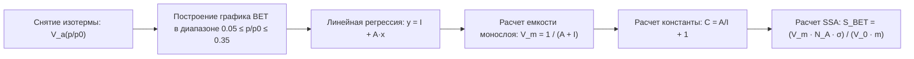

# Теория Брунауэра-Эммета-Теллера (BET) и физический эксперимент

Метод **BET (Брунауэра, Эммета, Теллера)** — фундаментальный физико-химический стандарт и общепринятая методология определения удельной площади поверхности (Specific Surface Area, SSA) высокодисперсных и нанопористых материалов путем низкотемпературной физической адсорбции газов (как правило, азота $N_2$ при температуре кипения $77.35\text{ К}$).

---

## Физическая модель и уравнение изотермы BET

Теория развивает модель мономолекулярной адсорбции Ленгмюра на случай **полимолекулярного (многослойного)** осаждения молекул газа на твердую поверхность:
1. Молекулы адсорбата первого слоя взаимодействуют непосредственно с центрами поверхности адсорбента с теплотой адсорбции $q_1$.
2. Молекулы второго и последующих слоев адсорбируются на уже осевших молекулах, причем теплота их конденсации считается равной теплоте сжижения чистого пара $q_L$.
3. Испарение и конденсация молекул в каждом слое находятся в динамическом квазиравновесии.

Линейная форма уравнения BET:
$$\frac{p}{V_a (p_0 - p)} = \frac{1}{V_m C} + \frac{C - 1}{V_m C} \left(\frac{p}{p_0}\right) \quad (1.16)$$
где:
- $p/p_0$ — относительное равновесное давление газа ($p_0$ — давление насыщения пара при температуре опыта, для $N_2$ около $760\text{ мм рт. ст.}$),
- $V_a$ — объем поглощенного газа, приведенный к стандартным условиям (STP),
- $V_m$ — емкость монослоя (объем газа, необходимый для сплошного мономолекулярного покрытия всей доступной поверхности),
- $C$ — константа BET:
$$C \approx \exp\left(\frac{q_1 - q_L}{R T}\right) \quad (1.17)$$

---

## Определение удельной площади поверхности

Строится экспериментальный график в координатах:
$$y = \frac{p}{V_a (p_0 - p)}, \quad x = \frac{p}{p_0}$$

В линейной области ($0.05 \le p/p_0 \le 0.35$) определяются коэффициенты прямой:
- тангенс угла наклона $A = \frac{C - 1}{V_m C}$,
- свободный член (пересечение с осью ординат) $I = \frac{1}{V_m C}$.

Отсюда аналитически вычисляются параметры модели:
$$V_m = \frac{1}{A + I} \quad (1.18)$$
$$C = \frac{A}{I} + 1 \quad (1.19)$$

Суммарная площадь поверхности образца $S_{total}$:
$$S_{total} = \frac{V_m \cdot N_A \cdot \sigma}{V_0} \quad (1.20)$$

Удельная площадь поверхности (на единицу массы):
$$S_{BET} = \frac{S_{total}}{m} = \frac{V_m \cdot N_A \cdot \sigma}{V_0 \cdot m} \quad [\text{м}^2/\text{г}] \quad (1.21)$$

Константы для адсорбции азота ($N_2$) при $77.35\text{ К}$:
- $\sigma = 0.162\text{ нм}^2 = 0.162 \times 10^{-18}\text{ м}^2$ — посадочная площадка молекулы азота,
- $N_A = 6.022 \times 10^{23}\text{ моль}^{-1}$ — число Авогадро,
- $V_0 = 22414\text{ см}^3/\text{моль}$ — молярный объем газа при нормальных условиях.

---

## Многоточечный и одноточечный режимы

1. **Многоточечный метод (Multi-point BET):**
   Регистрация объема адсорбции минимум в 3–7 точках. Критерием достоверности эксперимента служит коэффициент корреляции линейной регрессии $R \ge 0.9975$ ($R^2 \ge 0.995$) и положительное значение константы $C > 0$.
2. **Одноточечный метод (Single-point BET):**
   Применяется для рутинного контроля однотипных партий адсорбентов при $p/p_0 \approx 0.300$. В предположении $C \gg 1$ второй член уравнения стремится к 1, что дает:
   $$V_m \approx V_a \left(1 - \frac{p}{p_0}\right) \quad (1.27)$$
   Погрешность одноточечного метода относительно многоточечного обычно не превышает 2–5% при $C > 50$.

---

## Особенности физического эксперимента и источники погрешностей

В диссертации использованы экспериментальные данные BET, полученные на автоматических анализаторах типа Micromeritics. Однако при сопоставлении с численными 3D моделями учитываются физические факторы расхождения:
1. **Капиллярная конденсация в мезопорах:** при повышенных давлениях в узких порах начинается преждевременная конденсация жидкости, искажающая изотерму монослоя.
2. **Влияние тупиковых и ультрамикропор:** молекулы азота не могут проникнуть в тупиковые или замкнутые поры менее $0.4\text{ нм}$, тогда как при компьютерной 3D томографии эти области могут быть учтены или наоборот сглажены.
3. **Неполная дегазация поверхности:** наличие остаточной влаги или органических загрязнений на стенках пор уменьшает эффективную емкость монослоя $V_m$.
4. **Атомарная микрошероховатость:** модель BET чувствительна к атомным шероховатостям стенок, которые сглаживаются воксельной сеткой томографа с размером пикселя $0.35\dots 0.5\text{ нм}$.

---
**Связанные разделы базы знаний:**
- [[Index|Карта содержания]]
- [[01_Глава_1_Изучение_морфологии_пористых_сред|Глава 1. Изучение морфологии пористых сред]]
- [[структуры/Обзор_исследуемых_пористых_структур|Экспериментальные параметры исследуемых структур]]
- [[03_Глава_3_Анализ_результатов_и_взаимосвязи_морфологии|Глава 3. Сравнение расчетов с BET]]
