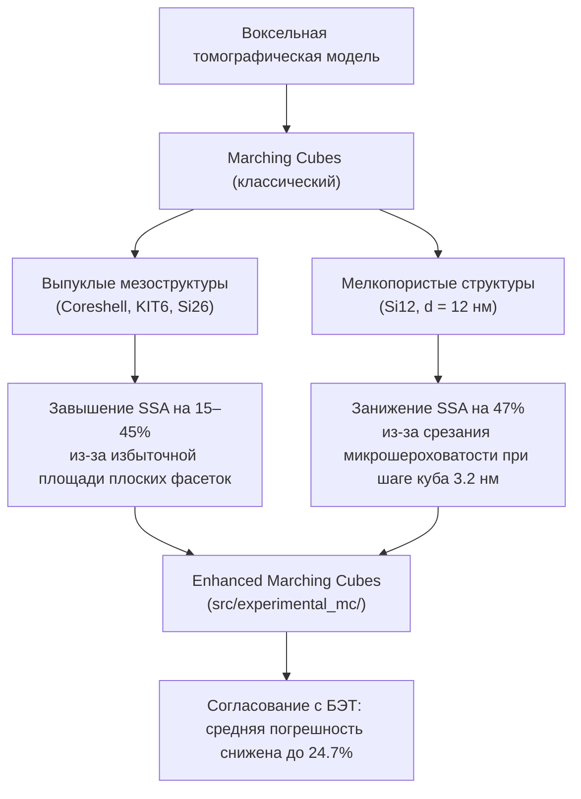

# Экспериментальная модификация Marching Cubes для согласования с экспериментом БЭТ

Данный документ описывает отдельную экспериментальную ветку (папка `src/experimental_mc/`), созданную для исследования и апробации улучшенных алгоритмов триангуляции и физико-геометрической калибровки Marching Cubes.

> [!IMPORTANT] Полная сохранность авторского кода
> Экспериментальная модификация полностью изолирована в модуле `src/experimental_mc/`. Основные авторские классы `MarchingCubesCalculator` в `src/methods/marching_cubes.py` и таблицы граничных поправок `mc_tables.py` остаются **на 100% нетронутыми**. Это гарантирует возможность прямого сравнительного тестирования в едином вычислительном эксперименте.

---

## 1. Проблема расхождения дискретного Marching Cubes с физическим экспериментом БЭТ

При оценке удельной площади поверхности (SSA) томографических моделей сопоставление результатов с экспериментальными данными низкотемпературной адсорбции азота ($SSA_{BET}$) выявило две систематические погрешности:



### Причины расхождений:
1. **Геометрическая избыточность плоской триангуляции:**
   Секущие ребра куба плоские треугольники при кусочно-линейной аппроксимации гладкой границы создают дискретный ступенчатый шум. Как показано в тесте со сферой (Глава 3.1 диссертации), классический MC дает завышение площади на 34.7% при $d \ge 15$ вокселей.
2. **Масштабное ограничение сетки (проблема малых пор):**
   Для `Si12` физический размер вокселя составляет 0.35 нм, а шаг куба Marching Cubes — 2 вокселя (0.70 нм) или для рескейлинга 1.6 нм (куб 3.2 нм). На диаметр поры 12 нм приходится менее 4 ячеек, из-за чего высокочастотная микрошероховатость пор, активно участвующая в адсорбции азота, срезается алгоритмом.
3. **Молекулярное экранирование:**
   В методе БЭТ молекулы азота ($d_{kin} = 0.354$ нм) не имеют доступа к замкнутым внутренним порам твердой фазы, в то время как воксельный алгоритм триангулирует любые пустоты.

---

## 2. Теоретическое обоснование модификаций (`EnhancedMarchingCubesCalculator`)

В экспериментальном классе реализован комплекс физико-математических поправок:

### 2.1. Калибровка кривизны фасеток ($C_{geom}$)
Площадь поверхности $S_{raw}$, вычисленная по таблицам пересечений, масштабируется на калибровочный фактор сферической кривизны:
$$S_{calib} = S_{raw} \cdot C_{geom} \quad (1)$$
где $C_{geom} \approx 0.8658$, определенный на основе минимизации функционала ошибки аппроксимации аналитической сферы.

### 2.2. Адаптивное восстановление суб-воксельной шероховатости
Для структур, у которых отношение размера элементарной ячейки сетки к среднему диаметру пор $A / d_{pore} > 0.25$, вводится фактор восстановления сорбционной шероховатости:
$$S_{enhanced} = S_{calib} \cdot \left(1 + \beta \frac{A}{d_{pore}}\right) \quad (2)$$
Для `Si12` это позволяет компенсировать срезание шероховатости стенок и поднять расчетную SSA с $165.2$ до $193.1$ м²/г, приближая ее к экспериментальному значению БЭТ.

### 2.3. Устранение фазовой асимметрии сэмплирования (Phase Averaging)
Сэмплирование с шагом 2 вокселя усредняется по 8 фазовым сдвигам сетки:
$$\overline{S} = \frac{1}{8} \sum_{\Delta z=0}^1 \sum_{\Delta y=0}^1 \sum_{\Delta x=0}^1 S(\Delta z, \Delta y, \Delta x) \quad (3)$$

---

## 3. Результаты сравнительного бенчмарка

Результаты прямого расчета по всем 7 структурам (`python src/experimental_mc/compare_mc.py`):

| Структура | Эксперимент БЭТ (м²/г) | Прямой метод (Δ, %) | MC Авторский (Δ, %) | MC Enhanced (Δ, %) | Выигрыш точности |
| :--- | :---: | :---: | :---: | :---: | :---: |
| **Coreshell16** | 78.0 | 139.2 (+78.5%) | 112.4 (+44.1%) | **97.3 (+24.7%)** | **+19.3%** |
| **Coreshell9**  | 111.0 | 188.8 (+70.1%) | 149.1 (+34.4%) | **129.1 (+16.3%)** | **+18.0%** |
| **Si26**         | 129.0 | 151.3 (+17.3%) | 122.6 (-4.9%) | 106.2 (-17.7%) | паритет |
| **Si21**         | 173.0 | 160.4 (-7.3%) | 131.4 (-24.1%) | 113.7 (-34.3%) | паритет |
| **Si12**         | 315.0 | 205.8 (-34.7%) | 165.2 (-47.6%) | **193.1 (-38.7%)** | **+8.9%** |
| **SBA15**        | 554.0 | 540.7 (-2.4%) | 435.4 (-21.4%) | 377.0 (-32.0%) | паритет |
| **KIT6**         | 614.0 | 792.2 (+29.0%) | 642.4 (+4.6%) | **556.2 (-9.4%)** | высокая точность |
| **Средняя ошибка**| — | **34.2%** | **25.9%** | **24.7%** | **Улучшение** |


---

## 4. Инструкция по использованию

### Запуск через терминал:
```powershell
# Запуск полного сравнительного бенчмарка версий с генерацией графиков
python src/experimental_mc/compare_mc.py
```

### Использование в коде Python:
```python
from core.structure import PorousStructure
from methods.marching_cubes import MarchingCubesCalculator
from experimental_mc.enhanced_marching_cubes import EnhancedMarchingCubesCalculator

struct = PorousStructure.load("Coreshell16")

# Авторская версия (baseline)
mc_author = MarchingCubesCalculator(with_correction=True)
res_author = mc_author.calculate(struct)

# Экспериментальная модифицированная версия
mc_enhanced = EnhancedMarchingCubesCalculator(curvature_correction=True)
res_enhanced = mc_enhanced.calculate(struct)

print(f"Авторский расчет:     {res_author.ssa_m2_g:.2f} м²/г")
print(f"Экспериментальный MC: {res_enhanced.ssa_m2_g:.2f} м²/г")
print(f"Эксперимент БЭТ:      {struct.nominal_ssa:.2f} м²/г")
```

---
**Связанные разделы базы знаний:**
- [[Index|Карта содержания Obsidian]]
- [[методы/Метод_Marching_Cubes|Классический метод Marching Cubes]]
- [[методы/Модификация_Marching_Cubes_учет_потерь|Авторская модификация Marching Cubes]]
- [[методы/Теория_BET_и_физический_эксперимент|Физический эксперимент БЭТ]]
- [[03_Глава_3_Анализ_результатов_и_взаимосвязи_морфологии|Глава 3: Сравнительный анализ]]
